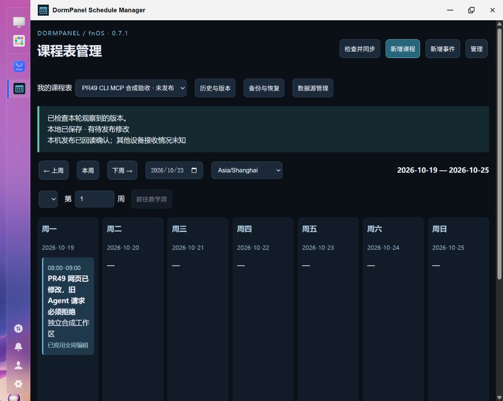

# PR49：FPK 0.7.1 CLI / MCP 验证记录

本 PR 基于 main `c6b2dc9`。原任务目标为 0.7.0；实装发现 fnOS `target` 符号链接会令 CLI/MCP 的入口判断跳过执行，已使用 realpath 修复并加入 Linux 符号链接回归。fnOS 拒绝覆盖同版本包，按用户后续指示将最终版本更新为 **0.7.1**，通过官方应用中心完成最终原位升级。没有合并、创建 tag 或发布 Release。

## 交付与覆盖

随包安装 `target/bin/dormpanel-cli` 和 `target/bin/dormpanel-mcp`，同一确定性操作目录开放 69 项操作，覆盖系统诊断、课表与原始记录、领域编辑、ICS/CSV 导入、工作区、连接与授权目录、同步冲突、历史 DAG/快照/比较/回退、归档精简、加密备份恢复和数据集迁移。具体命令、输入 schema、资源 URI、六个 Prompt 和 SSH 配置见 [使用说明](fpk-0.7.1-agent-guide.md)。

共享操作层经私有 `agent.sock` 调用原网页业务处理器；CLI/MCP 不初始化 Catalog 或 Workspace。权限、工作区/dataset/revision/catalogVersion、网络与维护互斥、原冲突/历史/恢复 token、迁移保护都由服务端检查。权限初始只读；高影响操作绑定摘要，由原网页的管理员认证和 CSRF 通道独立批准。意图/回执、权限、批准及有界审计不随旧应用备份回退。

## 代码与构建验证

| 验证 | 结果与证据 |
| --- | --- |
| Windows 最终 Node 测试 | 188 项：123 通过、65 项 Linux 专项跳过、0 失败。[日志](evidence/pr49/windows-node-tests.txt) |
| fnOS 官方 Node 22.18.0、非 root 包用户，最终 0.7.1 | 188 项：187 通过、1 项非 Linux 专项跳过、0 失败。[日志](evidence/pr49/fnos-node-tests.txt) |
| 页面回归 | 1280×800，21/21 通过，无失败。[日志](evidence/pr49/browser-tests.txt) |
| 新增 Agent 测试 | 包含 CLI JSON/退出码/参数/分页、默认只读与降级、网页 CSRF 隔离、三入口一致性、过期修改拒绝、重复 ID/响应丢失/重启账本、独立批准绑定、课程/事件/覆盖/学期/日期/来源/导入、退役保护、敏感内容不入审计、现代/旧版 SDK 客户端、符号链接入口；Linux 另实际完成共享本地数据集、同步回执、历史比较/快照/回退/归档/精简及加密备份验证/取消/恢复闭环。均使用临时合成状态 |
| 生命周期与权限 | 原有 start 竞争、SIGKILL 残留、停止/重启、无关 PID、ACL 撤销与符号链接拒绝均在最终 fnOS 全套通过；新增 Socket 纳入同一启动锁和权限检查 |
| 官方 FPK | `npm run check`、`npm run build`、官方 fnpack 1.2.4、生产 npm 安装审计 0 漏洞；最终包 27 份源码/Web/package 逐字节一致，检查 CLI/MCP 包装器、官方 SDK 依赖、无 MCP 客户端/Playwright、网关仍只注册 app.sock。[包验证](evidence/pr49/package-verification.json) |

新增服务端测试包括真实 Socket 与官方 MCP 客户端，不以工具名称注册成功替代业务结果验证。现有迁移测试继续覆盖归档/候选/实际目标验证、设备登记、冻结/切换/退役及保护失败；未宣称在已安装的日用实例再次完成多端换库。

## 已安装 FPK 与跨机器验收

测试机使用任务指定的 fnOS。SSH 账号、口令、连接秘密、原始配置和私有目录内容均不进入提交。

- **官方原位升级：** 0.6.1 → 初始 0.7.0 时，36 份既有 JSON 状态（包括工作区帧、身份、Catalog、原 WebDAV 配置及迁移记录）哈希完全一致。最终 0.7.0 → 0.7.1 时，包含新增合成工作区的 38 份状态哈希也完全一致。最终包通过应用中心上传、用户批准后正常更新和启动；最终实例不依赖手工替换文件。[升级与并发摘要](evidence/pr49/upgrade-and-concurrency.json)
- **安装文件：** 最终实例 27 份源码/Web/package 与最终候选源码逐字节一致；SDK Server 2.3.1 在生产 node_modules，MCP 客户端 SDK 和 Playwright 不存在。
- **CLI：** 以包用户通过实际安装路径查询版本/健康、创建独立私有本地连接与合成工作区、显式创建共享 dataset、编辑课程并发布，返回真实回读回执。没有修改原日用工作区业务记录。
- **真实 SSH stdio：** 从 Windows 工作机使用官方 Client 2.3.1，经 Python Paramiko stdio 桥接真实 SSH 通道，以 NAS 管理员的 sudo 身份启动已安装包装器；没有创建额外 Writer。两次分别实际协商 **2026-07-28**、**2025-11-25**，发现 69 Tools、3 Resources、7 Resource Templates、6 Prompts，资源读取通过；两种协议都完成合成课程新增/详情/删除、同 ID 重试、过期写拒绝、回执查询和同步发布。[新协议](evidence/pr49/ssh-modern.json)、[旧协议](evidence/pr49/ssh-legacy.json)
- **SSH 权限与 cwd：** 包装器使用官方 Node 22 并切换安装目录；账号无有效 HOME 时的系统警告进入 stderr（69 字节），不污染 stdout JSON-RPC。没有保存 SSH 密钥、增加 sudoers 或扩大 Socket ACL。文档中的标准 `ssh -T ... sudo -n ...` 配置须由管理员先配置密钥和限定命令的免密 sudo；本轮实际认证使用上述受控密码引导桥接，不冒称该账号原本就可免密启动。
- **真实网页并发：** 管理页面打开独立合成工作区，CLI 先读取 revision 55。通过原 fnOS 网关页面修改并保存全周覆盖后，CLI 使用旧 revision 尝试写入，服务端返回 `STALE`、退出码 **3**，原网页修改保留。页面见下图。
- **权限及恢复现场：** 测试后将活动工作区切回原默认工作区，权限恢复 `read`；合成工作区保留供复核。未授权 `nobody` UID 连接 Agent Socket 实际得到 `EACCES`；两个 Socket 均 owner-only 0600。[未授权用户](evidence/pr49/unauthorized-user.json)
- **停止/重启：** 官方 appcenter stop/start 正常；停止时 CLI health 返回退出码 **8**，没有创建另一份数据；38 份状态在重启前后哈希不变。[已安装检查](evidence/pr49/installed-final-check.json)
- **短时空闲：** 主进程 RSS 97,380 KiB；3 秒内 CPU 增加 1 tick。该测量只核对短时空闲行为，不代表长时性能、稳定性或四小时 soak；未新增常驻 MCP 守护进程或轮询。



## 最终候选

本地文件 `artifacts/pr49/dormpanel-schedule-manager-0.7.1.fpk`，SHA-256：

```text
04c3dc9542c7b23c24fc10fbef08bab8ba9beac70a30eea8991978766a91b3a4
```

二进制保留在本地，不上传 Release。0.7.0 中间包已被 0.7.1 取代。升级过程中短暂尝试修改 manifest 版本以诊断同版本拒绝，系统仍按安装登记判断，随即恢复原 manifest；最终使用正式递增版本的 FPK 更新，没有修改应用中心数据库或依靠此尝试完成安装。

## 限制与风险

未开放可选 HTTP MCP、公网代理、任意 SQL/shell/JavaScript、私有文件读取/编辑或旧库删除接口。MCP 通过 stdio/SSH 接入；正常课程编辑不依赖 LLM。

权限适用于能以包用户访问 IPC 的客户端集合，不能隔离已经能任意执行 root/包用户代码的恶意进程。高影响批准的独立边界是原管理网页；Agent 工具没有批准或修改权限接口。超过 24 小时的操作 ID 拒绝重放；意图存在而结果未落盘时保守返回 UNKNOWN，管理员需先检查状态，系统不会声称已完成或自动重做。

已安装实例只在独立合成工作区验收日常操作和并发，**没有在日用课表执行恢复、回退、精简或迁移**。这些维护闭环由同一最终源码、fnOS 包用户和隔离临时实例的测试覆盖；没有再次组织真实 Android/X08E 换库验收、离线设备停写证明、旧目录服务端禁写或物理清理。未执行长时 soak，也没有测量不同规模导入/历史读取的性能基线。导入、同步与迁移的原业务资源预算继续生效，单个大记录超过响应上限时明确返回 LIMIT。
