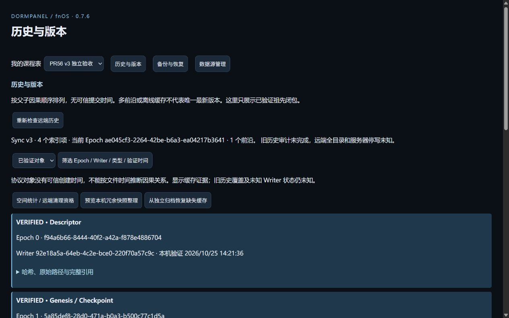

# PR56：Sync v3 历史与安全维护

基线：`04728d367b6030bc8cbcc9180ccf734f6360ed3f`。本文随实际验收更新；未列为实际执行的行为不代表 PASS。开发过程中创建 Draft，完成实际验收后提交审阅；不合并、不发布。

## 实现与边界

- Descriptor 发现走独立 `Catalog.discover`，不打开 Workspace，不进入成功/失败事务，不改变同步错误、revision 或业务帧。Web 原 POST 入口兼容；CLI/MCP 的两个发现操作使用 GET 与默认 read 权限。目录授权、管理员入口、原 WebDAV 身份及请求预算继续有效。
- v3 历史使用 SQLite sequence 游标，可按已验证、仅观察、待验证、异常、Epoch 分页，并按 Epoch / Writer / 对象类型过滤。无固定首 100 项限制。可筛选本机首次验证时间；协议对象不包含可信创建时间，旧索引的验证时间也可能未知，不能按 mtime 猜测因果顺序。
- 指定已验证 Genesis/Checkpoint/Commit 的八类 RAW 集合分页查看，复用已有稳定业务身份与关联组差异比较，可与另一个版本或当前全部 RAW 比较。快照缓存缺失时停止并提示审计/归档恢复，不伪造空快照。
- 回退预览与操作身份持久保存，确认核对用户、有效期、Workspace revision、完整业务帧、已知前沿及对象哈希。原同步引擎发布具有当前父关系的新提交；不修改旧对象或倒退前沿。保存后失败保留本地修改，重复操作返回原操作记录。
- 独立归档冻结已验证索引 high-water mark，每轮保存 1 个对象的进度，使用官方授权目录与原安全 V3 文件适配器写入并实际回读。每页最多 2 个对象，分页清单以 SHA-256 前向链接，完成清单只保存页数与末页哈希，均从实际文件回读核验；进度保存在同一私有索引，可重入。格式 `DormPanel-v3-history-2` 保留早期格式 1 的读取。恢复还复用原 `V3History` 在分页私有命名空间验证祖先、Checkpoint 和 Transition，未验证完不报告闭包完成。范围仅为实际已验证的对象集合与已知引用闭包，未知路径、旧 Writer 和服务端封存明确为未知。归档恢复仅填充同一 Descriptor 的私有缓存，不写远端；因果证明仍由原验证器负责。
- 空间统计区分 SQLite、缓存 blob、witness、损坏隔离及其他受保护文件，同时报告逻辑字节与 Linux st_blocks 文件分配量；不把文件系统快照保留或并发空间变化混称为本次回收。整理只考虑私有 SQLite 的无引用不可变快照，不删除任何缓存/witness/pin、损坏文件、远端对象或未知暂存。所有持久命名空间、恢复引用及文件 witness 参与失效检测；未知版本/命名空间、损坏校验或预算不足拒绝产生删除决策。
- 整理每次最多 256 行，删除与回执在同一 SQLite 事务中提交。小于 64 MiB 且有足够空间时用 SQLite 自身 VACUUM 和 WAL checkpoint 压缩，分别报告可复用页字节与实测文件释放量；压缩超预算时保留可复用页，文件释放量为零。
- 普通 WebDAV 的远端物理 GC 一律 `NOT_ELIGIBLE`。没有服务端永久停写证明，不提供强制删除、旧 Epoch 删除或以管理员勾选代替封存证据的入口。

## 完整应用备份

`DPBK0001` 继续使用原版本含义和读取规则。包含 v3 私有 SQLite/缓存/迁移材料时使用 `DPBK0002` / manifest v2；加密仍为原有 scrypt + AES-256-GCM，原文件数、单文件、总字节、清单、路径及授权限制不扩大。

维护互斥内逐个 SQLite 使用 `VACUUM INTO` 生成一致性副本，包含已提交 WAL 内容，不复制活动主文件冒充快照。归档覆盖私有元数据全部行、不可变 RAW、控制帧、候选/capture、回执、冲突/决策、审计/维护游标、安装身份、连接凭据、迁移及对象缓存/witness/pin。缺少 blob 的 witness 以哈希和 pin 明确列为外部恢复依赖。

验证阶段检查实际密文认证、文件 SHA-256、SQLite integrity、每行校验、快照引用、历史引用身份、安装 Writer、Descriptor 和缓存 witness；提交恢复决策前不替换活动库。恢复决策持久化后先关闭活动 SQLite，使用原恢复日志完成或重入，恢复前状态继续私有保留。活动 v3 的持久行、现有缓存/pin 或更新的迁移/恢复证据与备份不同则拒绝覆盖；旧格式不能覆盖活动 v3。恢复前快照及其必要保留链也纳入备份，而非只复制指向它的日志。

恢复后先隔离远端发布，按持久游标回读 Descriptor 与已知节点哈希，验证端点及绑定。这里只证明已知引用，不证明远端全部历史。应用私有状态备份与独立历史归档是两种不同范围的证据。

## 实际验证

| 检查 | 实际结果及范围 |
| --- | --- |
| Windows 静态检查 | `npm run check` 与 `git diff --check` 通过 |
| Android 构建 | `:app:assembleDebug :phone:assembleDebug` 成功；本 PR 未修改 Android、Room schema 或后台任务 |
| NAS 官方 Node 22 / 包用户定向回归 | 阶段性 110/110，通过 Catalog、Agent/CLI/MCP、v2/v3 接入与迁移、备份、写 API、索引边界及 Workspace 事务；后续维护/备份改动另行复验，不把阶段结果冒充最终整套重跑 |
| NAS 维护与备份复验 | 50/50：Descriptor 成功/失败无副作用、跨 Epoch 分页/回退、八类 RAW、WAL、UNCERTAIN/capture 的四个恢复中断点、清理提交前后故障、pin/新编辑失效、归档实际回读和缓存恢复、混合备份及深层私有 v3 路径 |
| 恢复前状态保留链 | 单独定向实际创建、验证、恢复后，再次备份包含保留的旧状态，通过 |
| 官方 FPK | 生产候选维持 0.7.6，fnpack 构建、42 份包内源文件逐字核验通过；最终哈希见下方交付记录 |
| 隔离官方安装与升级 | 独立包名 `dormpanel-pr56`，通过 fnOS 官方应用中心安装/升级，同一隔离工作区、安装 Writer、4 个历史对象及归档保持；运行 src/web 40 份文件按测试包标识转换后与仓库逐字核验 |
| 安装版实际页面 | 创建 v3 → 合成课程保存/同步 → RAW 差异 → 回退新 Commit，旧 Commit 保留 → 已知历史归档实际回读 → 本机无引用快照整理。一次实际整理删除 1 行、RAW 可复用 492 字节；VACUUM/checkpoint 前后主库与 WAL 合计减少 296648 字节。两种数值不是同一口径 |

后续针对归档完整性、索引损坏和冷工作区发现分别追加验证，结果见交付段。仅把实际执行的检查计作通过。测试包的安装元数据使用独立递增版本；生产 manifest、Android 版本、签名与发布状态未改。

## 预算与证据边界

- 应用备份保持 4096 文件、单文件 64 MiB、总计 256 MiB、清单 1 MiB 的原预算。超限明确失败，不生成不完整成功包。保留状态链最多嵌套 8 层；缺失或超限停止，不删除证据。
- 归档清单每个文件 128 KiB，最多 1000000 页；控制帧不积累所有页。每轮 1 个对象，并保留页内恢复位置。源对象原始字节不改写、不压缩。
- 整理可达性分析最多 20000 个记录/文件和 64 MiB 引用字节，超过预算或发现未知命名空间、未知 witness 版本、链接、损坏校验时拒绝删除。一次最多删除 256 个无引用 RAW 快照；大于 64 MiB 的数据库不进行自动 VACUUM，只报告 SQLite 可复用页。
- 归档的冻结索引范围、已知闭包、实际读回与历史远端观察分开记录。完成归档不表示未知远端路径不存在，也不表示服务端禁止旧 Writer 写入。远端 GC 一律 `NOT_ELIGIBLE`。
- X08E/Phone 保持既有准确的本机已保存、指定远端回读、预算续做与旧 Epoch 未完成摘要。本 PR 未在 Android 首页增加维护扫描或常驻 UI。

未执行真实断电、日用数据恢复/清理/迁移、全部服务器实现和新的 Android 实机矩阵。用异常注入和 SQLite 重开覆盖中断边界，不将其描述为真实断电验收。没有机械重跑 1024 次增长或四小时 soak。原始操作日志与本机候选产物归档在忽略提交的 `artifacts/pr56/`；NAS 验证使用独立临时目录，真实连接凭据未纳入提交。

## 原交付记录（审批修复前，56d4570）

- [结构化验证记录](evidence/pr56/verification.json) 区分不同轮次，不能相加冒充唯一测试数。维护/Agent 接入 33/33、维护与备份复验 50/50、维护专项 15/15；最后另有归档 2/2、审计中断重开 1/1、冷工作区及权限/CLI/MCP 14/14，均为 NAS 官方 Node 22 / 包用户实际执行、无失败和跳过。
- 冷工作区回归在隔离 SQLite 中移除格式标记，再调用 Web 兼容 POST 发现：返回候选，全部持久行和 Catalog revision 不变，工作区未被打开或修复。GET、CLI/MCP 默认 read 入口同样没有业务写事务。
- 安装版网页实际创建、重新认证、预览并恢复格式 2 的混合工作区备份；恢复后显示发布隔离，再经只读历史检查解除已知引用保护。同一工作区、安装 Writer 和 4 个历史对象保持。再次完整备份覆盖恢复前保留状态及独立归档证明索引，通过实际密文回读验证。
- 新格式归档经 4 次有界调用完成 2 页清单，完成后页面保留位置和验证结果。早期格式 1 的独立归档也经 4 次恢复调用完成实际对象回读、原因果验证器的闭包/前沿检查；未完成调用始终返回 complete=false，完成后 completeRemoteHistory 仍为 false。伪造前沿和缺少已验证 Descriptor 的空归档被拒绝。
- 安装版 CLI/IPC 与 MCP 实际默认只读发现、读取同一 4 对象历史，SQLite 全部行调用前后 SHA-256 一致；MCP 实际列出 81 个工具，自动协商 2026-07-28，sync_discover 标记 readOnlyHint=true。
- 新建 `/dormpanel/pr56-maintenance-<随机 UUID>/` 隔离 HTTPS/WebDAV 目录，使用经可信 SSH 取得的精确公钥证书配置，未放宽全局 TLS。实际创建、编辑、同步和回退共 4 次 PUT；发现前后持久行及 PUT 计数不变，旧 3 对象 SHA-256 不变，新回退 Commit 的父引用指向当前前沿。此项为 NAS LAN 5006 的实际验证，不是公网域名、所有服务器或三端实机矩阵。
- 最终生产 FPK 仍为 **0.7.6**，SHA-256：`28c1594b295cd8c84500eae1f84474c67308d17ac6473c3672732a12e1e1f789`。官方构建逐字核验 42 份源文件；独立安装包 `dormpanel-pr56` 的测试元数据版本为 0.7.16，运行 src/web 40 份文件按包名转换后与仓库一致。没有覆盖日用安装、合并、打 tag 或发布 Release。
- 最终页面以 1280×800 实际检查；v3 精简按钮保持禁用，远端物理 GC 仍为 NOT_ELIGIBLE。历史归档与应用备份的覆盖范围分别展示。

## CLI/MCP 独立审批修复追加验收

审查基线为 `56d45701ace63ddac78cb97141c4d5b09ab6b431`，在原 PR56 分支修复，不修改 DPV3/3、SQLite 表/格式版本、备份容器、Android 或正式版本号。

- v3 回退预览持久记录创建它的 workspaceId；Web 预览读取/回退、CLI/MCP 批准摘要均经同一 previewRecord 校验 Token、Workspace、可信调用用户、有效期、当前 revision 与状态指纹。旧预览缺少归属字段时必须重新预览，不按所在目录猜测归属。原目标、前沿、冲突/Pending、持久操作回执和重复请求保护继续有效。
- 整理批准摘要改为 Workspace、版本/有效期、候选数量、预计 SQLite 可复用字节、计划指纹、完整候选集 SHA-256 及首/中/尾最多 3 个候选样本；还区分新计划与已提交后的续做。完整候选仍留在原 SQLite 预览，删除阶段继续复验完整引用、Pin 和候选集合。Agent 的 16 KiB 上限、maintenance 权限、独立管理员批准及操作 ID/参数/Token 的 HMAC 绑定均未改变。
- 新增 13 项 Agent 审批回归。真实 CLI 和官方 MCP SDK stdio 分别完成预览 → 申请 → 未批准拒绝 → 网页管理员批准 → 执行 → 相同操作重放；回退产生当前父引用的新 Commit，旧字节保持。256 个候选由 257 次真实 Workspace 编辑产生，CLI/MCP 申请记录均为 **1277 / 16384 字节**，批准后仍低于上限，完整删除 256 个候选并保留当前业务状态。
- 负例覆盖缺失/错误 Workspace、错误用户/目标、失效 Token/revision、批准后到期、新远端前沿，以及整理批准后的新 Pin、引用、候选、新编辑、Pending 和权限撤销。候选变化测试特意保持状态指纹不变，由完整候选集合复验拒绝。提交后故障保留 ROWS_REMOVED 原子回执，相同操作不重放；重开同一 Catalog 工作区并取得新批准后仅续做压缩，快照不二次删除。
- Windows Node 24 定向测试：`agent.test.mjs`、`pr56-maintenance.test.mjs`、`active-v3.test.mjs`，**40 通过、0 失败、9 项 Linux 专属跳过**。NAS 官方 Node 22、包用户、相同三个文件：**49/49 通过、0 失败、0 跳过**，包含原有 v2 网页/Agent 回退、精简、备份恢复的批准路径。`npm run check` 和 `git diff --check` 通过。
- [本次结构化验证](evidence/pr56/approval-fix.json) 单独记录，未重跑官方 FPK 安装、Android/NAS 全矩阵、1024 增长或 soak；未执行真实断电。本节之前的 FPK 哈希、安装源码逐字核验和截图仅对应原交付候选，不冒充本次审批补丁的安装验收。
