# PR65 验收记录

基线：PR64 合并后的 `6832986d825e8ad62348f5cbe18b8b065fff13d2`。验收日期：2026-10-28。

## 最终 UX 与数据语义收尾（基线 122fa77274e6ff3a5fe0cddc6d5e621c70381600）

- 公共默认值按当前勾选时段及其独立草稿动态计算。新增条目仍默认不参与，表单明确列出当前适用时段；勾选加入后，不一致字段清空默认展示并标注“各时段不同”。已主动输入或启用的统一草稿不会被参与状态变化覆盖，未启用字段不应用到业务记录。预览列出准确的适用时段。
- 核对了现有 `putClassOverride(null, key)`、ScheduleMerge 的“缺失记录即删除”规则和活动 v3 write 入口。批量全 null patch 现在是恢复继承意图：同一次受保护事务中删除对应全周覆盖，其他项目仍可新增/更新。`ClassPatch.isEmpty()` 不把 `""` 视为空修改；已有指定周覆盖不删除。没有改变协议、Room schema、Writer 或因果规则。
- 编辑器提供“恢复时段 N 全部继承”草稿操作；预览明确显示移除全周覆盖，最终投影及修改标记随持久状态恢复。没有实际差异时不生成空新记录。预览与验证共用 `CourseBatch.applyOverrides` 的结果。
- v3 write 捕获异常后，仅在元数据已有 `requiresReopen` 保护状态时保留原因为 `ScheduleCommitUnconfirmed`。此访问器只读取既有 closed 状态，不新增持久提交状态机。普通校验失败、明确回滚仍返回原异常；已确认提交但读取失败仍沿用上一轮独立回执。
- 未确认结果显示“保存结果尚待确认”，保留草稿、事务证据与写入保护，禁用保存。只指向原有“重开活动 Store”入口；恢复后重新读取真实状态，没有强制重试或假定成功。

本轮实际验证：
- JVM 定向 **17 项通过**：CourseBatchTest 14 项、CourseFinalSemanticsTest 3 项，覆盖全 null 与显式空字符串、混合新增/更新/移除、指定周投影标记、删除对未变化分支的传播及删除/并发编辑冲突。
- MIX 2S 隔离 testbed **6 项通过（79.472 秒）**：公共字段参与状态及已输入草稿、预览返回再排除、明确恢复继承与无修改记录、未确认提交提示及恢复后真实数据；v2/v3 两个正式 Room Writer 的混合原子提交、故障与冷读同步；复用“已提交但刷新失败”的 UI 回归。
- 混合事务中包含删除 a 全周覆盖、更新 b 教师、新增 c 的显式空备注。v2 第二项之后插入故障验证整批回滚；v3 提交前故障明确回滚、普通字段错误不被归为未确认、提交后确认中断进入保护；重开后发布并在另一 Room 端冷读，不复活 a 的覆盖，指定周覆盖和 c 的空字符串保留。
- 最后公共提示文案完善后，相关 **2 项 UI 重跑通过（27.507 秒）**。
- Phone testbed APK、测试 APK、X08E Debug 构建通过，diff 检查通过。只更新隔离测试包。
- 本轮只增加最小 v2/v3 删除传播与恢复验证，沿用此前三端网络和导入验收；未重复完整网络往返、RC、增长或 soak。

验证边界：新增本地条目只有勾选后才属于公共字段适用集合；空覆盖清理仅针对本次明确提交的全周 key，不自动清理历史或指定周记录；不确定结果仍需要原有恢复机制和实际回读确认。中断为故障点注入，未执行物理断电。

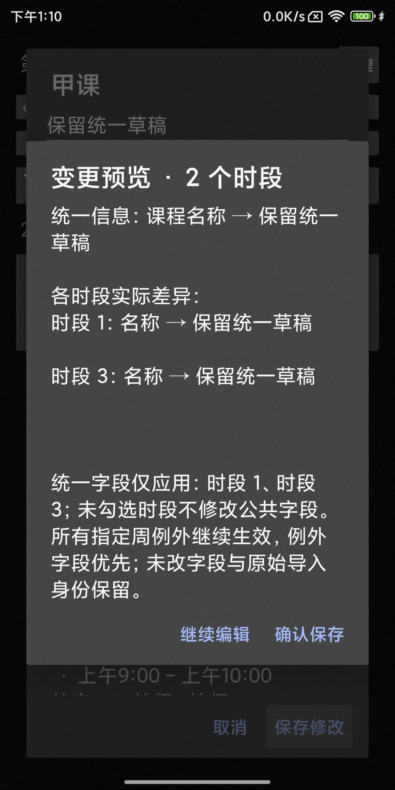
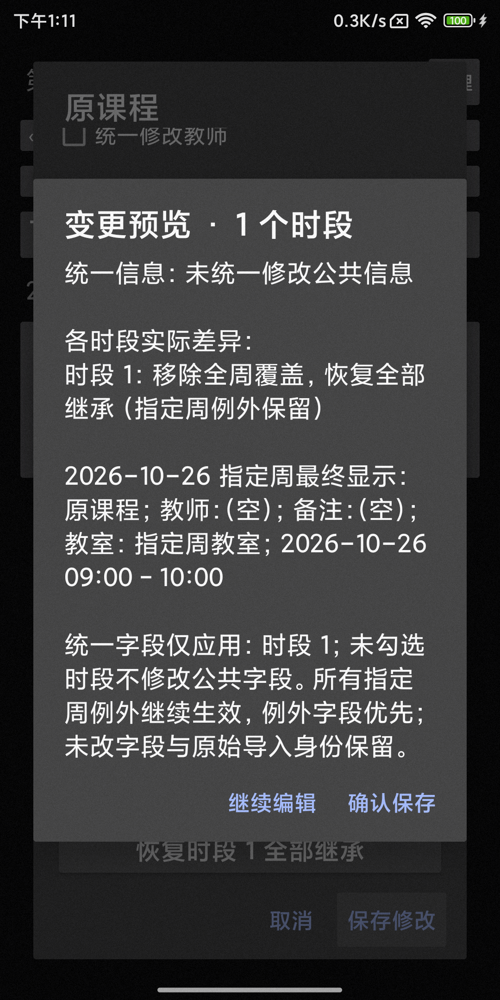
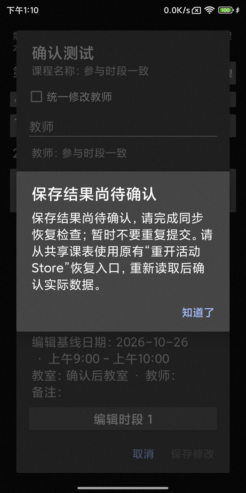

## 审查收尾修复（基线 361d0b3377f603e446c9de7fd24e7df14958c7ea）

本轮只修复课程管理枚举、参与草稿、重新加载和提交反馈，沿用下方此前整体验收证据；没有重跑三端网络往返、故障矩阵或完整导入流程。

- 新增只读编辑索引 `editingOccurrences`，在日期调整和指定周例外组合之前枚举系列。编辑界面使用同一 ClassEditSession 的无日期调整基线；原有效课表投影保持原行为，日期调整影响另行展示。完全无课的系列仍可编辑，原始实例与全周/单周覆盖不重建。
- 本地课程默认仅展开当前 entry ID。通过“添加其他本地课程”显式添加条目，卡片默认未勾选；列表附上星期和时间以区分同名本地条目，没有永久分组模型。
- 编辑未选时段后自动勾选并标注已纳入保存。如果用户再次排除已编辑时段，预览前必须选择纳入、明确放弃或返回检查；放弃后同时重置卡片摘要。
- “放弃草稿并重新加载”先确认，读取成功后关闭旧编辑器，按新基线直接重开对应课程；读取失败则保留旧草稿及读取保护。没有额外打开课程管理列表冒充差异比较。
- 批量提交成功后返回 `ClassBatchSaveReceipt`，单独表达刷新是否成功。提交已确认而刷新失败时明确显示“已保存到本机，但重新读取失败”，保留 Source.error/只读状态，阻止后续同步通知，并提供原有恢复读取入口。

本轮实际验证：
- `:phone-app:assembleX08eTest`、`:phone-app:assembleX08eTestAndroidTest`、`:app:assembleDebug` 通过。
- `CourseBatchTest` 14 项通过，含新增的“一个系列被日期调整完全隐藏，编辑索引仍保留全部系列和原始实例 ID”测试。
- MIX 2S 隔离 testbed：`CourseReviewTest` 5 项通过（42.302 秒），分别覆盖隐藏系列保存、同名本地显式添加与排除决策、并发修改后重载且不残留旧弹窗、真实 Room 提交成功但刷新失败的回执与读取保护、对应 UI 提示和恢复读取。
- 随后对隐藏系列已有覆盖保留、附加草稿明确放弃/再次编辑补充断言，相关 2 项重跑通过（25.588 秒）。
- 没有升级日用安装，未合并或发布。本轮只安装隔离 `com.dormpanel.timetable.testbed`。

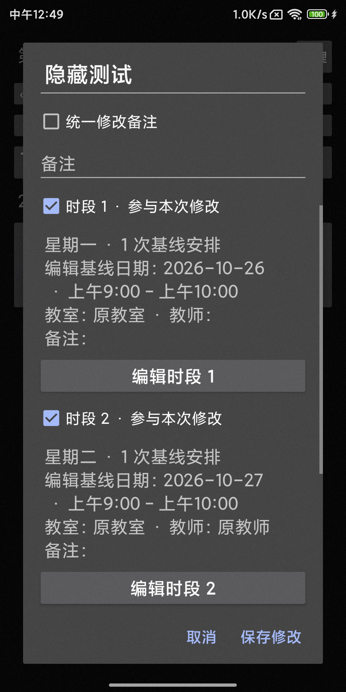
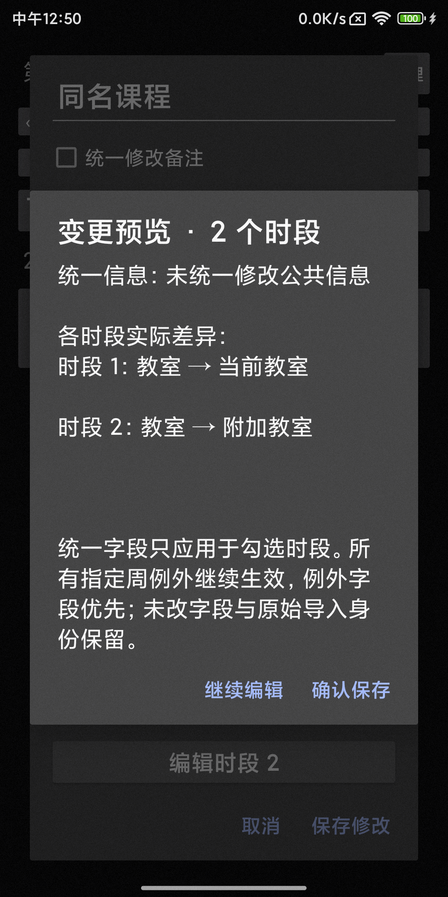
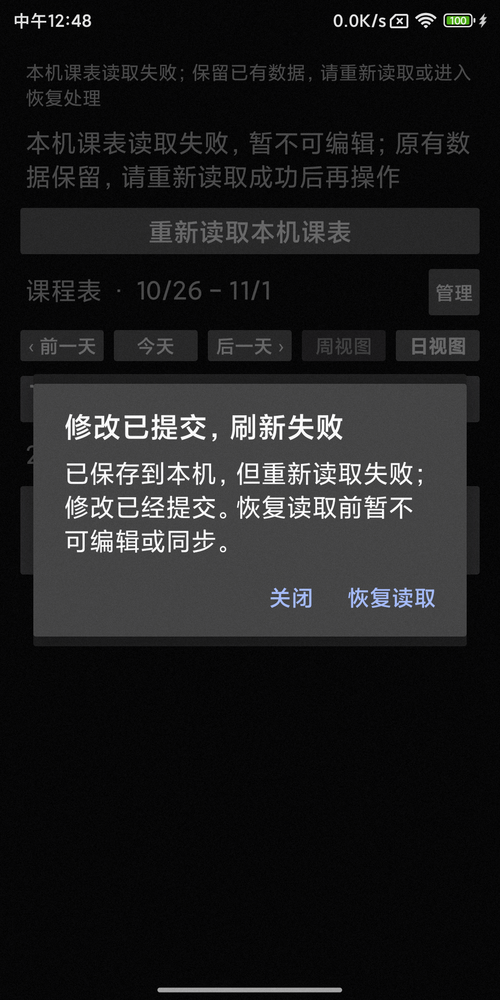

以下为此前整体实现与验收记录。

## 实现与实机修复

Phone 增加课程管理列表与课程详情中的“管理整门课”。候选分组只读取原始来源、名称和系列身份，跨来源分开，本地条目保持独立；同一系列原始实例名称不同只显示一个明确标注的歧义候选。列表显示当前全周课程名称，保留原始名称提示，并订阅保存后的状态刷新。

编辑器支持显式选择参与时段、勾选统一名称/教师/备注、独立星期/节次/自定义时间/教室草稿、取消、预览和一次保存。实际教学周逐项列举；较长日期集合可展开查看全部日期。预览分别列出统一信息、时段实际差异及指定周例外的最终投影值。保留原有单系列编辑、单周例外、原始导入关联和精确的 null/空字符串语义。

批量 API 复用 Room `write` / 活动 v3 `engine.edit`，在事务中重新检查捕获的课表、活动版本、写入资格、来源与系列、记录/文本预算和有效课程字段。全部提交后才回执“已保存到本机”，复用现有后续同步安排。没有改协议对象、业务字段、Writer 身份或数据库结构。

实机发现并修复：
- 未绑定 Room 不应调用需要完整同步目录的 fullState；使用正式读取状态，补齐实际学期配置后比较。
- 投影对非法时间覆盖的回退不能作为合法性判断；事务内先用 ClassEditSession 验证提交字段。
- 独立修改教室/时间时保留原覆盖中未触及字段的精确继承/清空意图。
- 公共默认值取排除指定周例外的全周草稿；预览通过同一投影计算例外最终显示。

## 本机定向验证

- Phone 与 X08E 隔离 `x08eTest` 应用和测试 APK 构建通过；没有更新日用包。
- JVM 定向 42 项通过：CourseBatchTest 13、ClassEditSessionTest 3、CsvImportFingerprintTest 5、CsvImportReplacementTest 4、HubeiCsvTimetableParserTest 13、HubeiXlsReaderTest 4。
- 覆盖同名跨来源、本地同名独立、同系列多星期与原始实例名称变化、不连续实际日期、补课复制日期、CSV/XLS 等价分组与投影、过期捕获、来源消失、非法时间/文本/记录预算、null 与空字符串、指定周最终预览。
- git diff --check 与网络脚本 Python 编译检查通过。

## MIX 2S 实机验收

设备 `210b601e`，包 `com.dormpanel.timetable.testbed`，原有 font_scale=1.25。

集中 9 项全部通过（181.431 秒）：CourseManagementTest 5 项、CourseBatchProtectionTest 3 项、PR64 原生横划定向回归 1 项。最后的列表刷新修改又通过相关 3 项表单回归；课程详情入口与键盘覆盖又通过深浅色 2 项验证（31.331 秒），实际截图确认软键盘出现时保存/取消仍可见。

- 管理列表、原始名称提示、全门课草稿、预览、确认保存、数据库关闭重开。
- CSV 和 XLS 两个真实脱敏夹具通过正式导入流程持久化，并混入同名本地条目；只修改选中系列的名称、教室与不同节次，保留未选中系列、不同教师/备注、单周例外和全部原始实例。
- 保存预览后继续编辑、取消整个表单不写入半成品；自定义 11:20–12:10、星期三及教室独立保存。
- 深浅色、1.25 字体、竖屏、只读可浏览且保存禁用；表单位于独立对话框，不向课表转发横划。
- 本地读取失败和应用快照期间，在调用 Store 前拒绝批量写入。
- 事务执行时的迁移保护、失效第二系列、导入替换和来源删除均拒绝整批草稿。
- 第二条 Room 写入触发 SQLite 故障时全部回滚。
- 活动 v3 提交前故障回滚；提交后确认故障进入保护，重新打开后恢复完整两条修改，再正常发布。
- PR64 左右横划、日/周切换与日期内容一致通过。
- 既有单系列全周/指定周编辑、日期调整、替换/删除来源，以及 CSV/XLS 文件选择器确认与重开回归通过（3 项，61.541 秒）。

## 真实 v2/v3 三端网络往返

Android：Phone MIX 2S 与 X08E `28605/A0UH93770`，均为隔离 testbed 包。fnOS：192.168.3.153 的官方 WebDAV，Node 22 运行当前源码的 Catalog/Workspace/活动 Writer；数据保存在随机 `/tmp/dormpanel-pr65-network-*`，不写日用工作区。

Android 所在网络不能直接路由到 fnOS，实测路径为 **ADB TCP → Windows TCP 转发 → fnOS 官方 WebDAV 5005**；fnOS Catalog 直接访问同一真实服务。转发只传输 TCP 字节，没有模拟 DAV 响应或改写协议。脚本完成后清理自身转发及临时参数文件。

两个协议分别使用随机目录，最后一次完整重跑：
- v2：`/dormpanel/pr65-v2-44aba3a4-2692-4deb-9f96-547ff74057c0/`
- v3：`/dormpanel/pr65-v3-6059049b-fe96-41c3-a74b-0279401eaf9d/`

每个协议执行：Phone 正式 Store 导入与创建 → Phone 批量 API 同事务修改两个系列名称/教师 → fnOS 通过正式 Catalog 加入与接收 → X08E 使用既有单系列 API 修改 a 的教室 → fnOS 通过 Workspace 编辑 b 的备注 → Phone、X08E 冷进程重新同步 → fnOS 重开 Catalog 后同步比较。

三端分别确认：两条全周覆盖名称为“PR65整门课程”、教师为“统一教师”，a 的教室为“X08E教室”，b 的备注为“fnOS备注”，指定周教室和例外教师保留。原始来源/系列/实例保持身份。两个协议的三端最终完整业务字节哈希均为：

`7fff424e2feab8cba363f81526334cb5eff7240a2164e347c8fff243bc4fc96f`

[机器可读三端回读结果](pr65-network-evidence.json)。此结论只覆盖本次已知测试端，不宣称未知设备接收或旧历史停写。

fnOS 侧边浏览器还通过现有隔离 FPK 页面新建“PR65 三端同步验收”工作区，明确选择既有 Descriptor 加入，完成同步，实际显示批量名称和指定周教室/教师。原工作区保留。

## 可复现入口

- `CourseBatchTest`、`CourseManagementTest`、`CourseBatchProtectionTest`。
- `CourseBatchNetworkTest` 同时编入 Phone / X08E testbed 测试 APK。
- `tools/verify_pr65_network.py` 从标准输入读取 host/username/password，自动安装隔离 APK、创建随机 DAV 目录、运行两协议三端往返并比较结果。
- `fnos-app/scripts/verify-course-batch.mjs` 只允许指定的随机 `/tmp` 测试根和 PR65 DAV 子目录，复用正式 Catalog / Workspace 接口。

## 实际截图

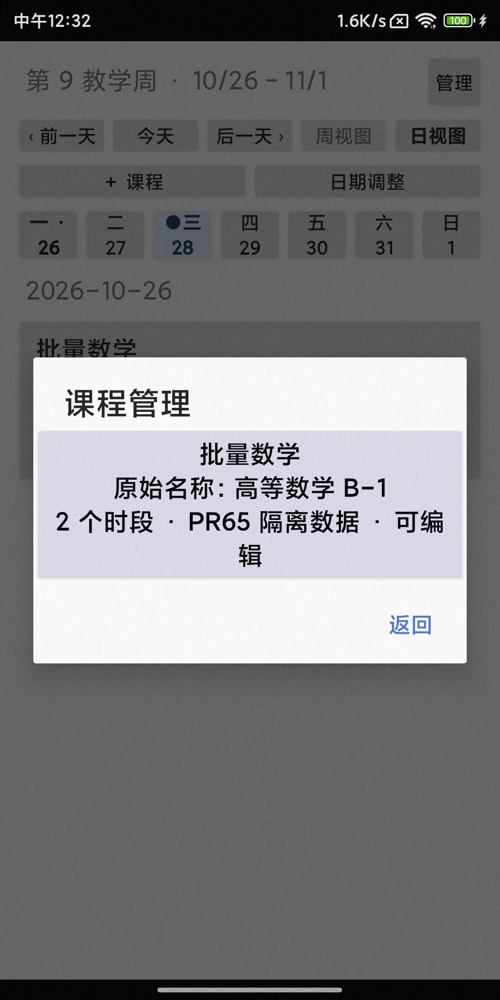
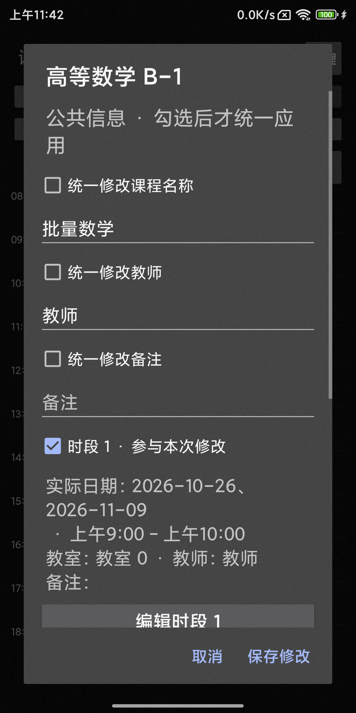
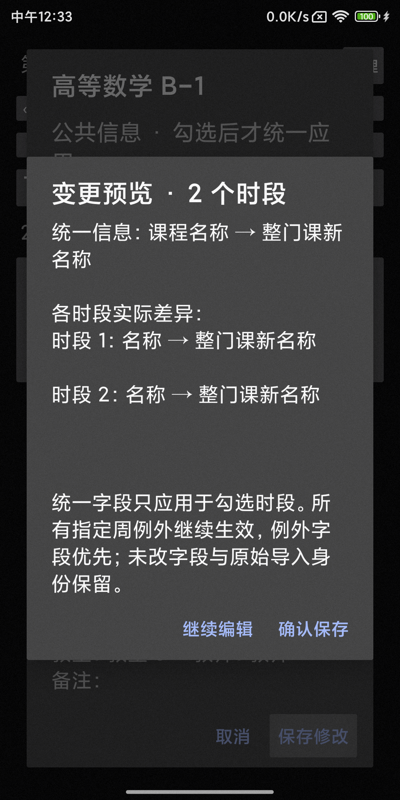
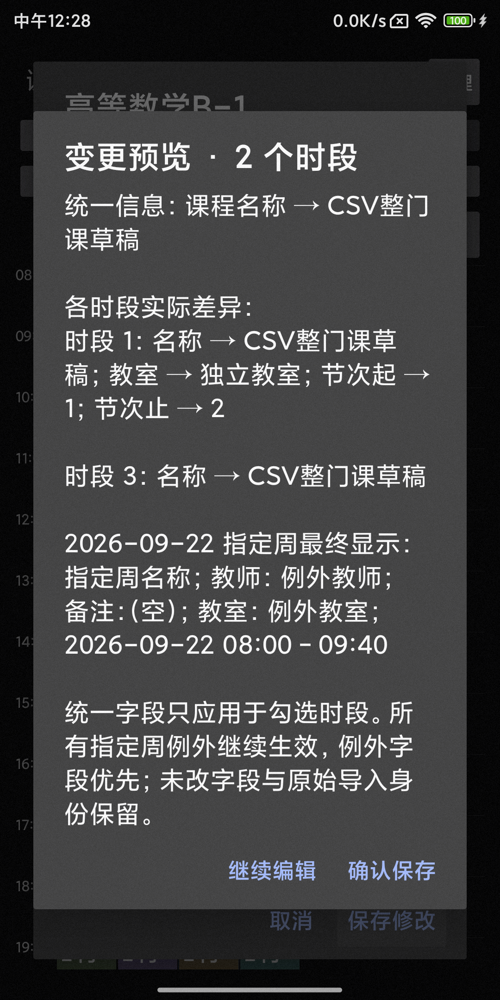
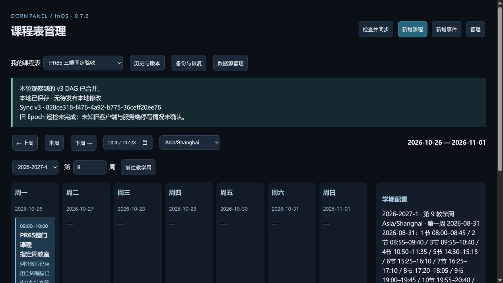
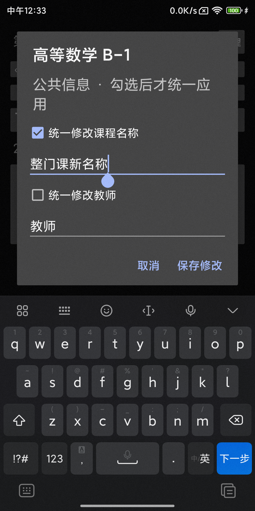

## 范围与验证边界

- 并发校验保守地比较完整课表，其他课程变更也会要求重新加载比较。
- 多星期共用一个 seriesId 时沿用现有模型的星期修改限制；不拆分身份，不编辑导入周次，不复制/删除原始时段。
- 中断恢复使用提交前/后的故障注入和多次进程、数据库重开；没有执行物理拔电。
- 没有执行跨网段 Wi-Fi 直连、全套 Sync v3 RC、1024 次增长或四小时 soak；本 PR 使用定向原子性、投影与真实往返验证。
- 初期一次全量 JVM 运行与另一 Gradle 测试任务重叠，因中间结果文件丢失失败；后续定向串行测试通过。没有声称全量 JVM 通过。
- GitHub 当前没有为此分支报告自动检查；以上结果均来自实际本机/测试机执行。

没有修改正式版本号、升级日用包、合并、打 tag 或发布。
