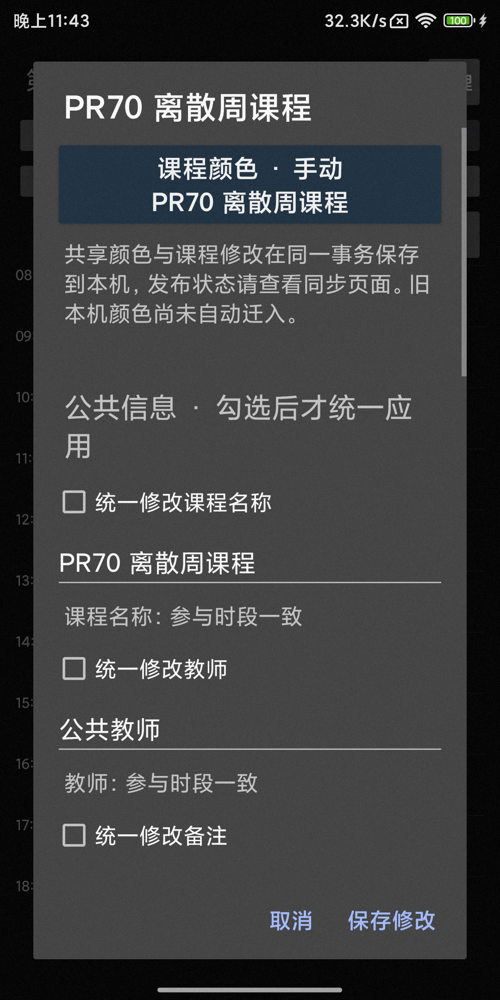
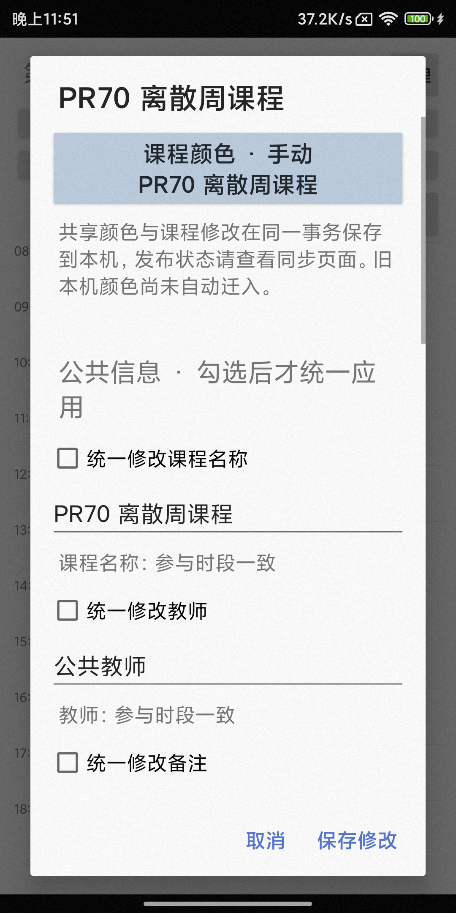
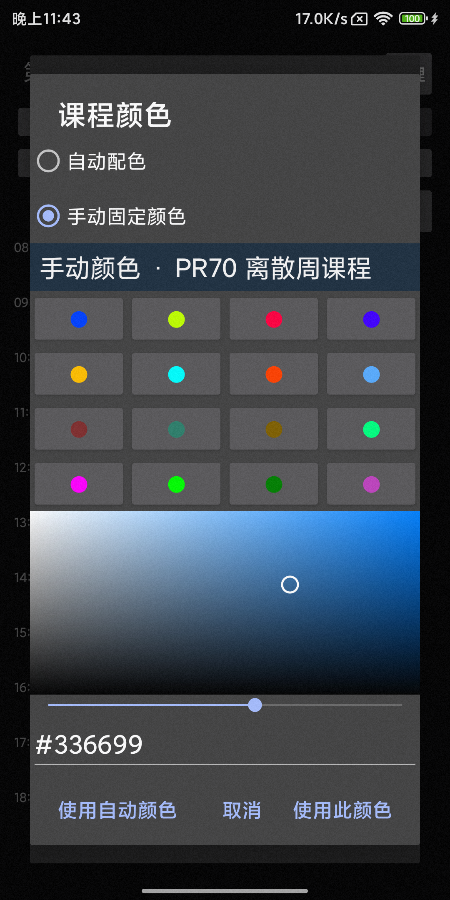
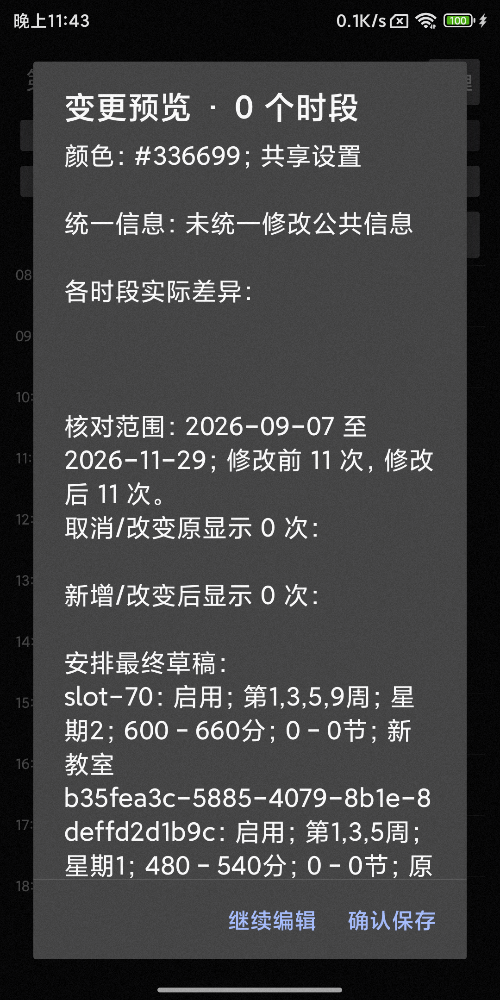
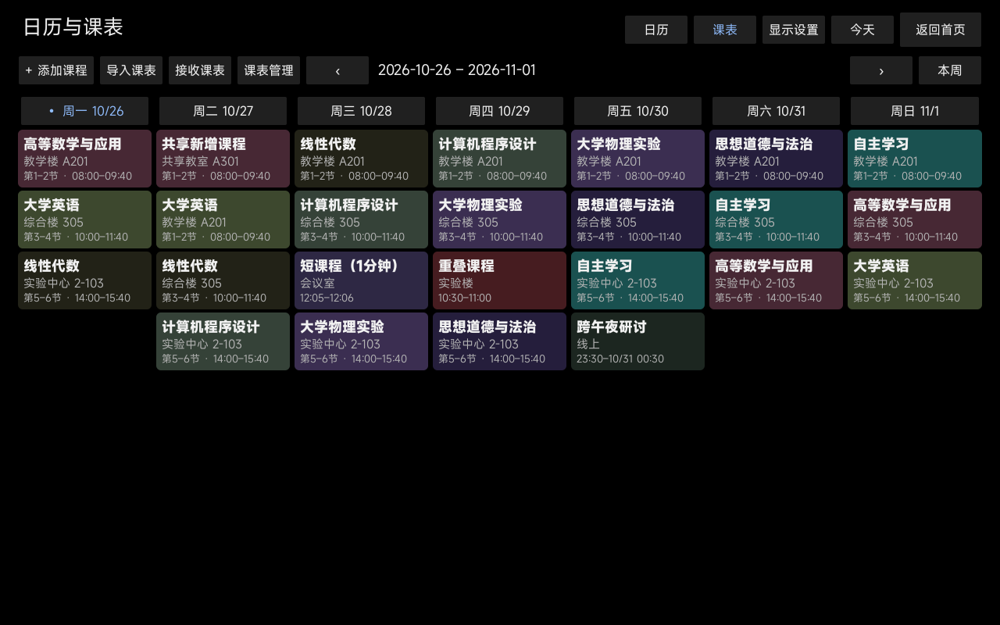
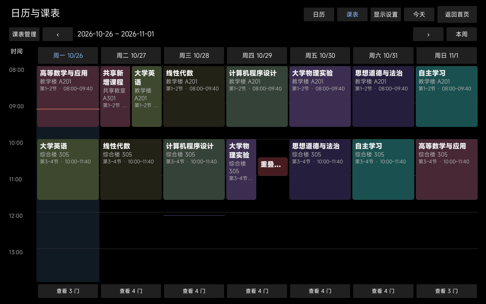
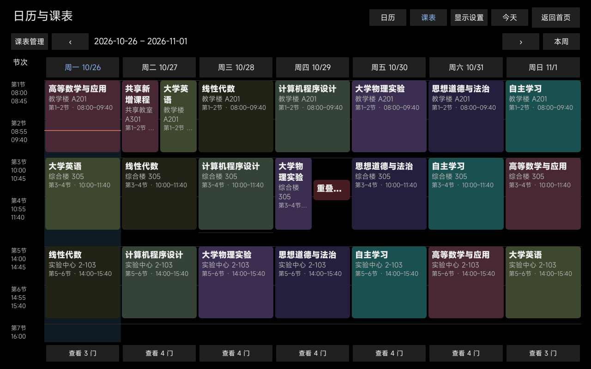

# PR70 定向验证记录

基线：最新 origin/main c85c29e，包含 PR69 合并 ac2f45f。仅使用隔离 Room、临时 Node Workspace、Fake WebDAV 和独立 Android testbed；没有改日用绑定、安装正式 APK/FPK、改版本号或创建 Release。

## 实际结果（2026-10-28 至 2026-10-29）

| 检查 | 结果 |
|---|---|
| JVM SharedCourseScheduleTest / CourseBatchTest / SharedRecordsTest / SyncV3Test | 33 PASS |
| Phone JVM 全部单测 | 36 PASS |
| Node shared-course-schedule、shared-state、projection、shared-records、shared-review、v3-workspace-transaction | 38 PASS，0 FAIL / SKIP |
| Phone 与 X08E assembleDebug | PASS |
| Phone 独立 testbed SharedCourseManagementTest | 主集合 4 PASS，141.186 秒；旋转恢复另 1 PASS，6.048 秒 |
| X08E 独立 testbed sharedSchedulesAndColorsThreeLayouts | 1 PASS，1280×800 三布局 |
| Phone Room → Node 正式 Workspace → Phone Room | PASS，完整业务哈希一致 |

Phone 实机另以禁止写入的 Fake Store 验证 Activity 重建后已接受的离散周草稿与公共教师字段保留；初次测试的窗口焦点匹配失败已修正并复跑通过。

Phone 实机包含：多字段覆盖、共享 RGB 和安排在一次正式 Writer 保存；过期 capture 拒绝且原状态不变；深浅色编辑与颜色选择；新增安排精确输入 1/3/5 周、保留草稿、最终预览、确认保存；Widget RemoteViews 读取共享安排与共享颜色，停用后投影消失；Node 修改后的完整状态经正式 Room Writer 提交并核对哈希。大字体为测试设备当前配置，保存按钮在可滚动内容之外。

X08E 实机以合成导入来源、有效作息及扩展安排测试经典、实际时间、节次三布局；断言新增实例地点、日期与共享 RGB，并生成截图。没有为 X08E 增加复杂管理界面。

双端新增测试覆盖固定 payload 字节与完整业务哈希、严格周集合、未知注册表 required 写保护、无关 ID 合并、同 ID 删除/编辑冲突、非连续周、原时段替换、指定周锚点保留、复制不继承原例外、停用和跨午夜。Node 正式 Workspace 另覆盖只读预览、无效父身份拒绝、颜色/安排同事务、过期 revision 拒绝、重开哈希保持。旧投影、Registry、迁移与事务恢复测试继续通过。

## 状态互操作证据

`SharedCourseManagementTest` 将实际 Room Writer 保存后的完整 DPV3/4 对象导出到 testbed 外部文件目录。`fnos-app/scripts/verify-pr70-room.mjs` 在新建临时 Workspace 中接收，以正式事务修改颜色为 8844cc、地点和备注，再导出。`nodeFixtureCommitsThroughRoomWriter` 经正式 Room Writer 保存并比较完整业务哈希。

- Phone 原始业务哈希：`d9b1f4010f5f822022b0154a6e3fa7feefc9632cc4f44be8cbff6391a6a620bc`
- Node 修改后及 Phone 回灌哈希：`0be10f7e674715fc413cf526b8066d77be15622311fa0246647afc42dbff1845`

此项证明真实 Room/Workspace 与协议对象互操作，**不是新增的 NAS HTTPS 网络同步验收**。本轮没有连接真实日用 WebDAV 目录；没有升级 NAS FPK。传输、Epoch/DAG 和回执机制未改写。

## 单独记录的基线失败

扩大 JVM 过滤器到 SyncV3* 时，61 项中出现 1 FAIL、1 SKIP：`SyncV3EngineTest.publishes1024AndRotatesWithoutGlobalCommitLimit` 在第 201 行缓存读取断言期望 0、实际 1。将未修改 HEAD/main 导出到 build/pr70-baseline 后单独运行同一方法，也在同一行以同一断言失败。这不是 PASS，也未将其改为宽松断言。本 PR 的直接定向 33 项仍全部通过；没有继续改 Epoch/DAG 或做四小时 soak。相关原始 XML 位于两个隔离构建目录的 test-results 下。

## 兼容与验证边界

旧 v2/v3 保留本机颜色和原有可支持的覆盖编辑；新增安排与共享色仅允许已显式启用 DPV3/4。迁入旧色需逐门确认，不清理旧偏好，不提供未经验证的活动绑定切换。目标回读、已发布和所有设备接收仍是不同证据。

未保存草稿的进程死亡恢复不属于已提交事务恢复；旋转保留已接受的课程草稿，尚未“保留草稿”的嵌套时段输入不持久化。没有验收真实 Launcher 上两种已放置 Widget 的点击/重启，本轮 Widget 证据是共用投影及 RemoteViews；既有点击、刷新和时间边界单测通过。没有做大量真实课程的长时间 UI 压力验收。

截图来自本轮隔离设备运行；最后的迁移预览说明、未知版本提示与保存预览标签调整已做编译/单测复验，未重拍所有截图。

## 截图

## 合并前四项审查修复（2026-10-29）

基线 9ea8c83。实际复验：核心 JVM 25 PASS（SharedCourseScheduleTest 5、CourseBatchTest 14、SharedRecordsTest 6）；Node 定向 35 PASS；Phone / X08E Debug 构建 PASS。Phone 独立 testbed 的有限周确认及旋转草稿测试 1 PASS（8.762 秒）。首轮发现错误提示位于滚动区域外，已修复为自动滚动到错误并复跑通过。

- 局部更新：正式 Workspace 先保存 B，再预览/保存 A；B 原记录保持相等，预览与提交业务哈希相等。过期删除拒绝，显式删除 A 后 B 仍在，重开哈希一致。所有调用已传明确 target 和 deleteIds。
- 来源：相同 sourceId/seriesId 的替换候选保留两种关联规则；系列消失/身份改变及带关联规则的删除被拒绝，原哈希不变。注入事务异常不提交，过期 revision 拒绝；明确删除两条关联规则后，来源删除成功，重开无悬空引用。Kotlin 同样验证存续、缺失与显式清除规则后的引用完整性。Android 扩展格式来源入口增加事务内 expectedHash 校验，旧格式入口不增加该限制。
- 颜色：只改教师且颜色 Unchanged 时扩展记录完全不变，与远端独立改色正常合并；已有手动色保留，Set(null) 明确产生 AUTO。Phone 无实际变更不提交，Node 缺省 color 不改色。
- 无限重复：新增本地安排从空集合开始；实机断言原无限重复替换没有 20 周默认，未勾选影响确认时拒绝；确认后两条离散周草稿均在 Activity 重建后保留，Fake Store 禁止任何提前写入。

保留的产品边界：不支持在保留来源依赖安排的同时删除来源，也不提供“来源+规则自动级联删除”组合操作。用户须先在独立课程草稿中明确移除关联规则、预览保存，再删除/替换来源；取消或任一步失败时，已存状态仍保持引用完整。没有按名称、文件名或新导入顺序猜测新系列身份。此安全边界属于本轮交付，而非隐式丢弃安排。

本轮没有新增 Android 来源替换/删除故障注入实机验收、NAS 真 WebDAV 或 X08E 截图复拍；来源事务失败/重开专项为 Node 正式 SQLite Workspace，Android 的新增来源 hash 入口经编译验证。此前未修改 main 已复现的 1024 增长缓存断言失败继续保留原记录，未重跑或放宽断言。

四项修复在上述明确产品边界下可进入人工 Review；仍保持 Draft，不自动合并、部署或发布。
