# PR71 fnOS 课程管理验收

基线：main `a1c99dedbfa07be7175f9af2661e2acff33b9468`。仅使用临时 Workspace、新建 NAS `test/pr71-isolated-…` 目录及 `.testbed` 测试包；未改日用绑定、日用课程、正式版本号或发布状态。隔离测试 APK 有重新安装，日用 APK/FPK 未升级。

## 实际验证

| 检查 | 结果 |
|---|---|
| Node Agent、课程安排、覆盖、投影、Registry、共享状态和正式 SQLite 事务定向集合 | 85 PASS，2 SKIP，0 FAIL |
| 新网页课程管理专项 | 8 PASS |
| 既有网页编辑、草稿、过期及迟到响应定向回归（含新入口正常流程） | 17 PASS |
| Phone / X08E 隔离测试包及 instrumentation 构建 | PASS |
| Phone Room → 真实 NAS WebDAV → Node Workspace | PASS，初始完整业务哈希相等 |
| NAS 原生 Node 22 Workspace 原子修改、发布、精确回读 | PASS，保留其他时段及指定周例外 |
| NAS → Phone Room / X08E Room | 各 1 PASS，最终完整哈希相等 |
| 同一已接收状态的 Kotlin / Node 三个周最终投影逐字段比较 | Phone、X08E 各 1 PASS |
| Phone 产品课程管理 UI 读取已接收状态 | 1 PASS，测试数据只读注入，禁止额外写入 |
| X08E 产品经典/时间/节次布局 × 彩色/单色 | 1 PASS，6 个组合，1280×800 |
| 真实 WebDAV 两个 Node Writer 并发及恢复 | 5 场景 PASS |
| 真实 Phone Room 与 fnOS Workspace 并发及恢复 | 5 场景 PASS，每场景 prepare/finish 两次设备 instrumentation |
| JavaScript 语法、FPK 工程、NAS 官方 fnpack、包内源码逐字节校验 | PASS；未安装 FPK |

Node 两个跳过项是原有 Linux 授权目录/加密备份 Agent 闭环，在 Windows 本轮未执行，不能计为通过。现有正式 SQLite、备份共享状态及既有业务定向测试通过；没有重跑全部旧版本迁移 RC。

网页覆盖时段分页、跨页草稿一次提交、有限替换确认、停用仍抑制原系列、移除规则恢复基线，以及实际多字段/颜色一次保存、预览只读、新增离散周、复制唯一 ID、停用、删除、取消不写入、过期拒绝与输入保留、响应丢失后只读核对完整候选哈希、不重发、迟到列表不能复活窗口及窄屏。真实 Catalog DPV3/4 的 HTTP/Agent 测试还覆盖管理员/CSRF、默认只读、edit 权限、严格 Schema、相同预览哈希、operationId 回执与重放、过期拒绝及 COMMIT 前故障整次回滚。

分组专项使用原始身份：同来源 A/B 归组，原始标题不一致的 C 独立，不同来源 D 独立，两个手动同名条目独立；停用规则仍在查询中。复用 PR70 事务测试覆盖多系列、未提交时段保留、部分覆盖、公共字段优先、来源引用、继承 linked、阶段和时区。

最终 FPK（仅本地构建，版本保持 0.8.1）SHA-256：`ba7f7bf8024439855f4b12f460e518a4c0f28a784c051cef38a23a3d45ac8d14`；包内 53 份源码/Web/配置逐字节校验通过。

## 真实网络证据

[完整记录](evidence/pr71/network.json)、[三周最终投影](evidence/pr71/projection.json)、[Node 并发](evidence/pr71/concurrency-node.json)、[Phone/fnOS 并发](evidence/pr71/concurrency-phone.json)。报告不包含凭据或证书。

- 隔离 DPV3/4 datasetId：`2ff519f2-601e-4fbe-8795-b9544f03a019`。
- Phone 首次发布：`ab9ae7eabdcc3293aca23f14017a381e5721f13d43d1df294d936563f00df17c`。
- fnOS 修改其中一个时段的地点与周次后：`c02d8ae12dae66d1285a5f898b5f3d456def0b2e011a89f01ad0d5addc9d5734`。
- Phone 增加指定周例外、NAS 再次原子修改公共教师，最终 NAS / Phone / X08E 均为：`6dd67433f92a36d2d0ac17636ab4dbb306c9b0a5c085877ae9cc1c910b11d5bb`。
- 共享 RGB 保持 `336699`；slot-a 周次由 1/3/5 改为 1/5、地点变为“fnOS 新教室”；slot-b 保留；指定周备注“保留指定周例外”保留。

Android 当前 Wi-Fi 无到 NAS 的直接路由。首轮直连失败如实保留；之后使用 `adb reverse` 和本机仅监听 loopback 的字节转发到真实 NAS 5006。TLS 在 Android 与 NAS 之间端到端验证，证书从 SSH 通道读取并作为连接级精确信任，没有关闭产品证书验证。Node 使用 NAS HTTPS，另在 NAS 自带 Node 22 实际运行同一 Workspace 发布并取得远端精确回读回执；不是离线 RAW 交换。

五个并发场景均使用独立 datasetId：不同课程修改、同课程教师/颜色分别修改自动合并；同色不同值、时段删除/编辑、来源变化/安排引用产生冲突。Phone/fnOS 专项先保留 Phone 本地未发布编辑，再发布另一 Writer 的并发分支，Phone 经真实网络发现冲突并明确选择 LOCAL，最后比较双方完整哈希。断网/未确认 PUT/待发布恢复及过期版本继续用已有隔离故障注入测试，未人为切断整个 NAS 或日用网络。

复现入口：`verify-pr71-network.mjs`、`verify-pr71-concurrency.mjs`、`verify-pr71-phone-concurrency.mjs`、`verify-pr71-projection.mjs` 和 Android `Pr71NetworkTest` / `Pr71ConcurrentTest`。私有配置位于忽略提交的 build 目录，不应上传；所有脚本拒绝非显式隔离路径。

## 边界与基线记录

网络样例是本地自定义时间安排；X08E 节次布局在缺少学术作息时按既有规则显示实际时间。linked、多时区、跨午夜、阶段和指定周锚点沿用 PR70 实现及本轮受影响定向测试，没有宣称穷尽所有真实网络组合。Phone/X08E 网络接收使用独立真实 Room/V3Engine；产品 UI 使用该已接收状态只读展示，并未切换日用绑定。

预览按显式范围计算最终投影，单次返回前 100 条和范围内总数；本地无限重复课程不声称已穷举无限未来。网页时段每页 20 条，跨页修改保留在同一草稿并一次保存；单次最多 100 个显式 upsert，未提交时段不受影响。未做全部课程数量上限的长时间浏览器压力测试。

PR70 已在未修改 main 复现的 1024 增长缓存断言失败继续保留 [原记录](pr70-validation.md)，本 PR 未改该路径、未重跑或计为通过。没有四小时 soak、日用升级、tag、Release 或自动合并。

## 截图

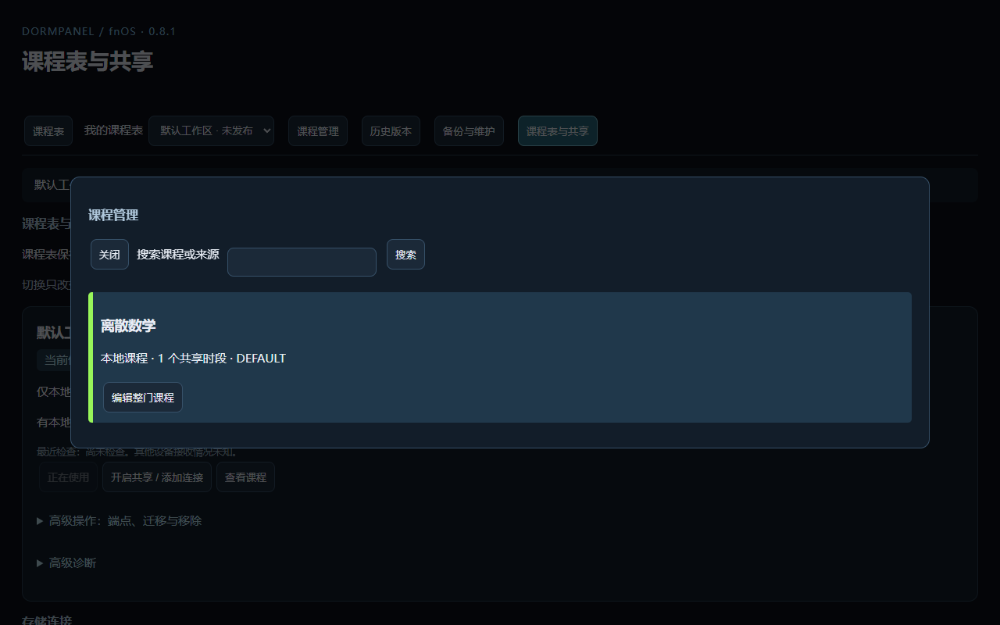
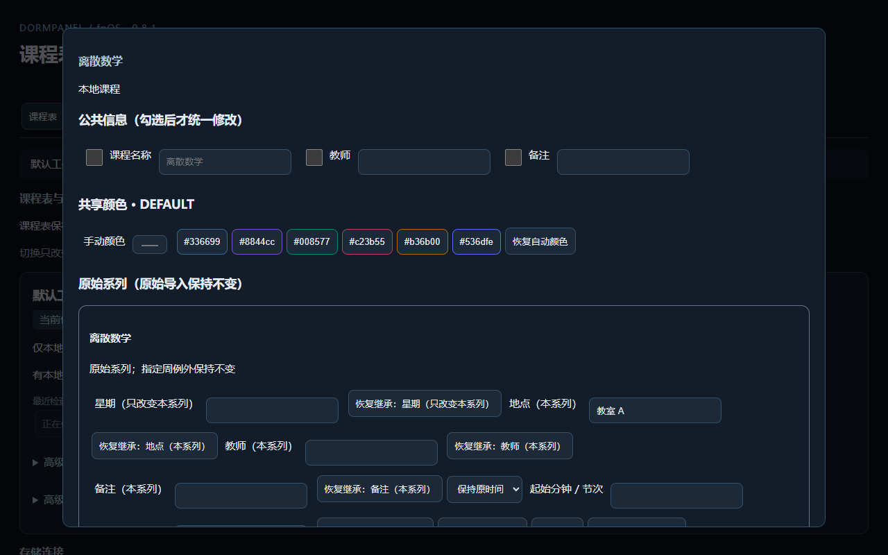
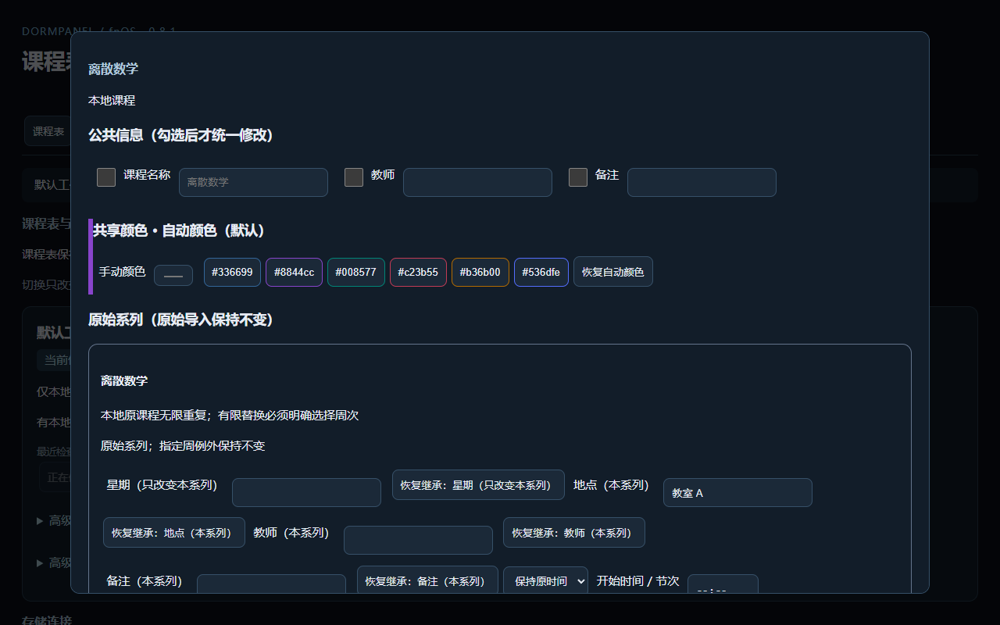
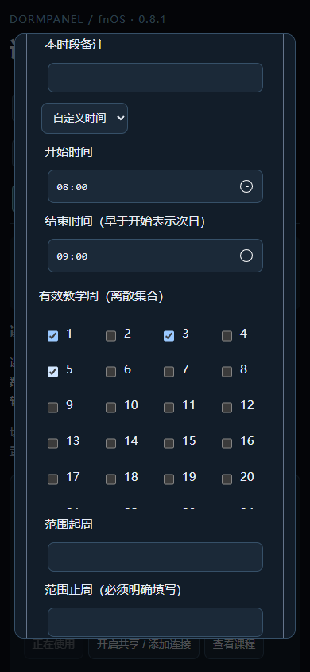
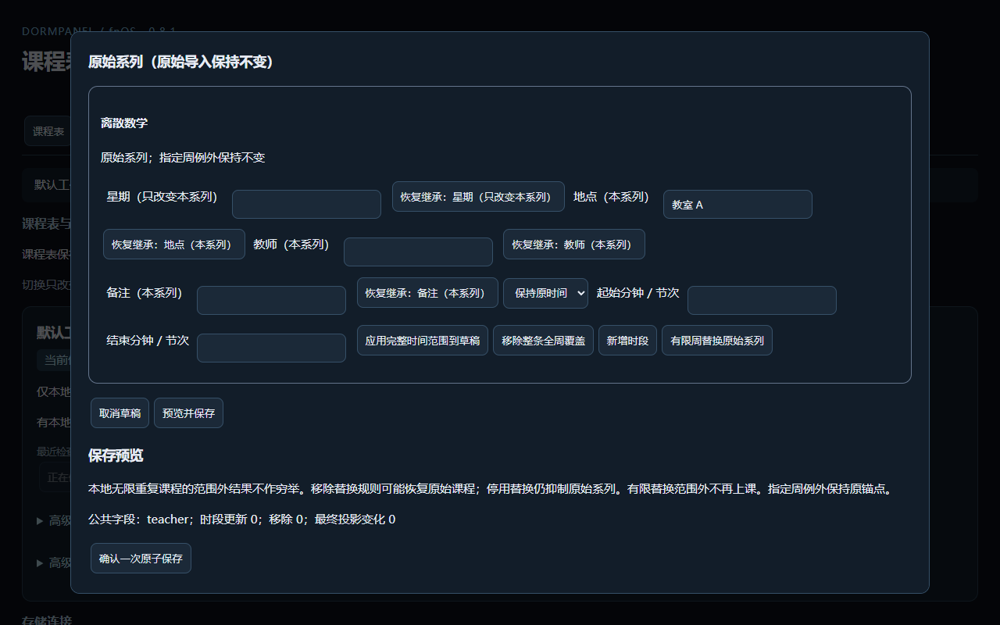
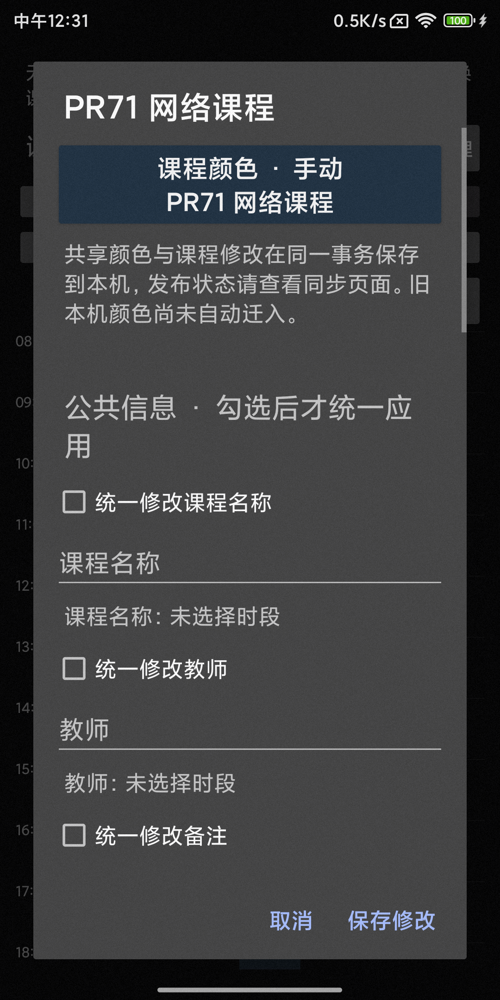
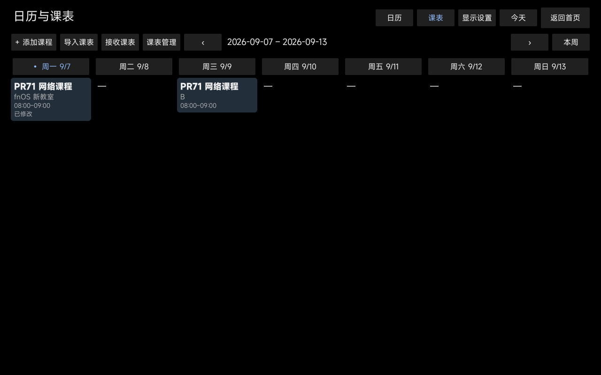
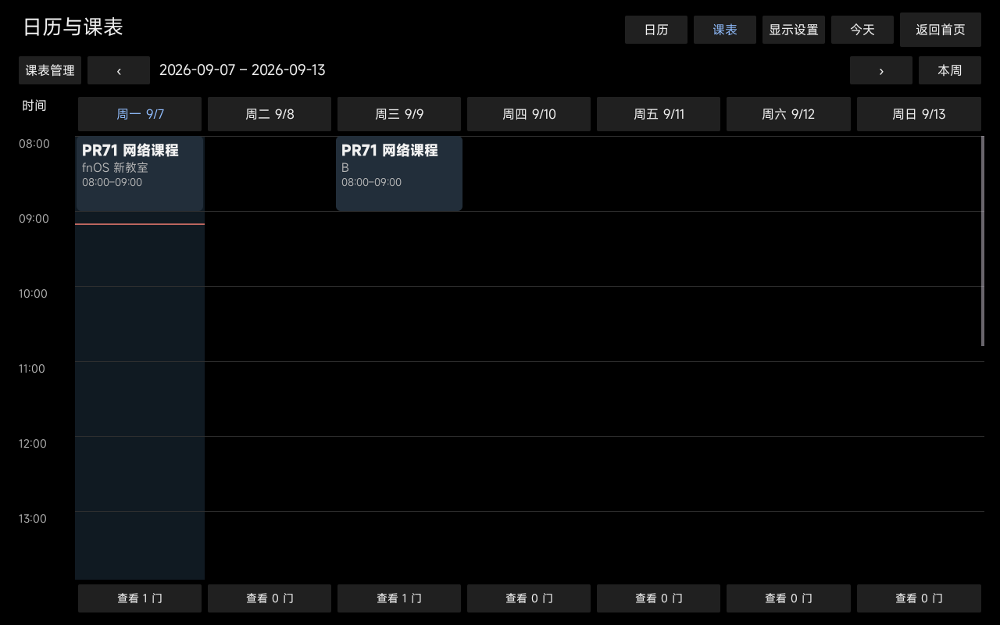
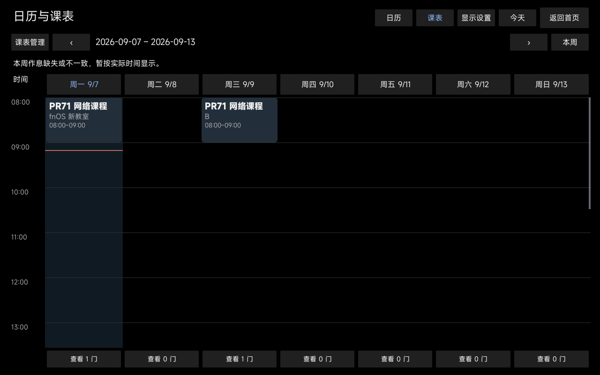
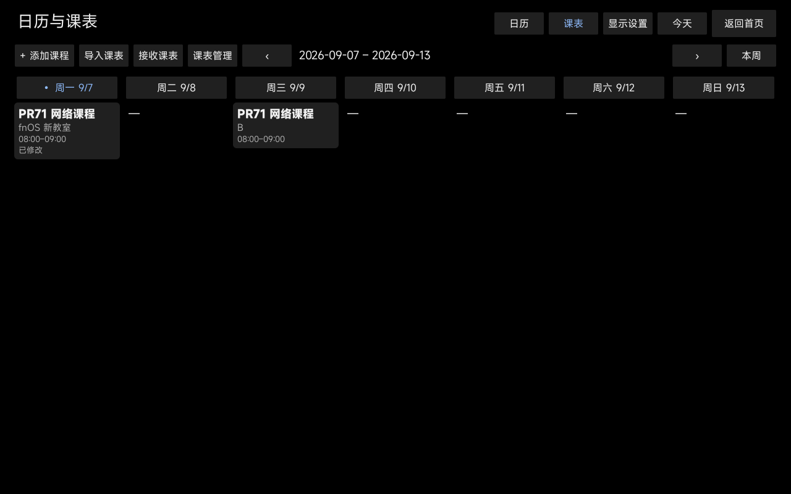

## 本轮审查修复（基线 840fb669，2026-10-29）

本节是本次重新执行的结果；以上真实 NAS、三端网络、Android 布局和官方 fnpack 结果仍为上一轮历史证据，本次未重复执行。

- 教学周：课程详情复用 ImportSource → `termKey()` → profile.week1Monday。周次按原始实例时区的学术日期计算；代表实例按时间/稳定 ID 排序，乱序不改变锚点、离散周或有限替换草稿。没有可靠学期关联时返回 unconfigured，不返回伪造的教学周锚点/周次，网页提示用户明确选择第 1 周周一及有效周；本地无限重复仍为 unbounded。已有导入、配置及合法共享安排不被重写。
- 恢复预览：使用正式 previewCourseEdit 的最终候选，按来源/原始系列检查剩余替换；停用规则仍抑制原课。删除 R1 同时新增 R2（含停用 R2）不会提示基线恢复，真正移除最后替换才提示恢复；网页删除明细同样使用该结论。
- 搜索竞态：窗口内每次搜索/列表分页独立递增请求世代；同时保留原窗口 ticket、工作区/loadEpoch/viewEpoch 保护。旧响应不覆盖新列表，不重置编辑草稿，无轮询。
- 颜色：原生 RGB 输入、预设色板、恢复自动共用内存草稿和即时色条更新函数；恢复自动仍提交 rgb:null，取消不写入。

本次实测：

| 检查 | 结果 |
|---|---|
| Node course-management / course-management-agent / course-edit-review / shared-course-schedule | 21 PASS，0 FAIL/SKIP |
| Playwright courses.browser | 14 PASS，0 FAIL/SKIP |
| 审查 HEAD 旧网页的搜索与分页竞态反证 | 2 个新增用例均 FAIL，修复后均 PASS |
| JavaScript 静态语法与 fnOS 工程构建 | PASS |

Node 新用例先复现错误锚点、无学期伪周次及删除重建错误恢复提示。日期 oracle 使用正式 projectWeek：学期首周 2026-09-07、课程第 4/6/10 周；还覆盖纽约周日 23:30 在上海已跨到下一周、CSV 既有 termKey 推导、实例乱序、缺失/无关联配置、本地无限重复与停用抑制。浏览器实际执行导入有限替换预览/保存，核对最终日期及原导入记录值；正式事务规范排序不视为改写实例。

浏览器竞态通过延迟 A/旧分页响应，让 B 先返回，等待旧响应完成后确认仍为 B；另覆盖关闭窗口、切换工作区后重新打开列表的迟到响应。颜色专项核对原生输入、色板、自动恢复的实际 CSS 色条，确认取消后 revision 和共享记录不变。原有多时段、跨页原子保存、指定周语义、颜色及 Agent 权限/回执定向测试继续通过。

未修改共享投影、协议或事务核心，本次不执行完整 Android、真实 NAS/并发矩阵、1024 增长、soak 或重新安装/发布。本轮定向测试未发现剩余失败；未穷尽浏览器/时区组合，历史验收边界和基线失败记录保持不变。

## 颜色状态与保存预览 UX 修复（基线 5fa2963d，2026-10-29）

本轮仅修改课程管理前端、样式及浏览器专项。后端课程查询、教学周、正式投影、HTTP/CLI/MCP、候选哈希与 Workspace 事务代码没有修改。以下结果是本轮实测，不替代以上历史验收记录。

- 颜色区分已保存的“当前”模式/RGB 与“待保存”草稿；DEFAULT、AUTO、MANUAL 保留含义，未知版本仍只读。原生输入、预设色、恢复自动共用状态/色条/输入框更新路径；即使手动 RGB 等于自动色，仍显示手动草稿。恢复自动保持 rgb:null，取消不写入，成功保存重读后清除待保存提示。
- 保存预览先显示公共字段、颜色及业务摘要，再提供默认折叠的时段/离散周明细、指定周例外明细及最终投影逐条差异。复制时段仅以本次 UI 操作的内存标记说明，不新增业务字段。周次范围仅做文字压缩，不填平离散周。
- 投影明细明确标记“共 N 条差异项，仅展示前 M 条”，说明同一实例字段变化可产生旧/新差异项，不将差异数量当作课程节数。覆盖范围、本地无限未来限制、有限替换、停用仍抑制、恢复基线及例外覆盖提示保持在默认摘要中；删除并重建替换不误报恢复。
- 确认保存区使用现有深色风格及底部粘滞布局，明细可键盘展开，不自动展开或请求更多预览。原有草稿失效、revision 拒绝、一次事务、无变化不提交及不确定结果不重发逻辑保留。

本次实际执行：

| 检查 | 结果 |
|---|---|
| Playwright courses.browser（新增 5 项，包含原 14 项） | 19 PASS，0 FAIL/SKIP |
| Node course-management、course-management-agent | 10 PASS，0 FAIL/SKIP |
| npm run check、npm run build | PASS，仅生成 fnOS 工程，未安装 |

新增专项覆盖：默认自动 → 同 RGB 手动并保存、手动 → 其他手动、恢复自动保存、取消后重开、未知版本只读；只改教师/颜色产生超过 100 条投影差异时默认折叠、准确总数与截断；窄屏 430×900、22px 字体、键盘展开/折叠；离散周修改、停用、复制、删除恢复与删除重建替换的摘要；无变更不提交。原有过期拒绝、草稿变化清除预览、回执丢失不重发及跨页原子保存测试继续通过。

实际打开临时本地服务的 Edge 页面，使用真实后端预览并检查截图：教师例子返回 206 条差异，默认摘要没有铺开 100 条记录；展开后仅显示后端返回的前 100 条。已检查宽屏摘要、颜色状态及窄屏展开截图；另断言展开时确认按钮仍位于可见视口内。旧 PR71 截图保持不变。

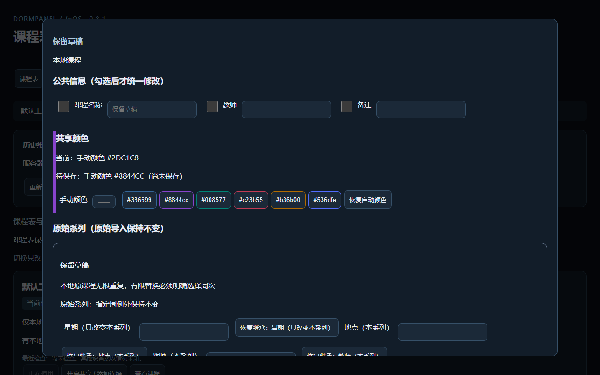
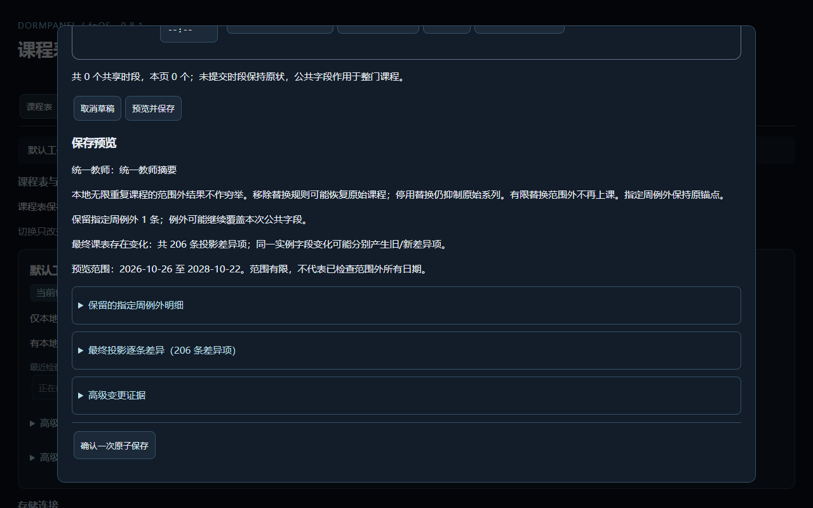
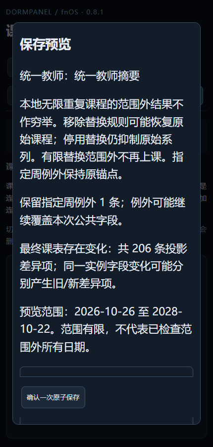
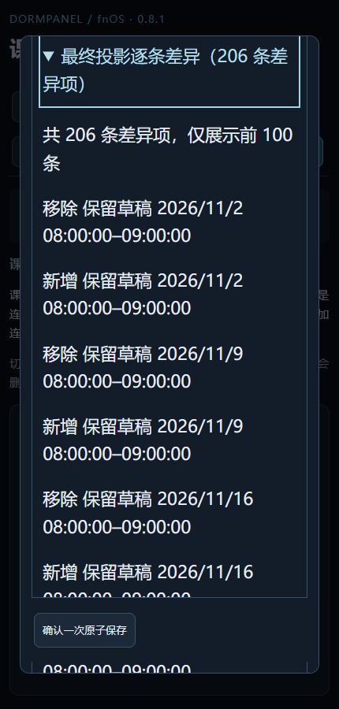

本轮未重跑真实 NAS 三端网络、Android 布局、CLI/MCP 全量、官方 fnpack、增长或 soak；这些路径未修改。未穷尽所有浏览器和字体组合；定向检查未发现剩余失败。未安装日用 APK/FPK、修改版本、合并或发布。
