# PR62：Phone 周视图验收

基线：`4667cd4`（已合并 PR61 的 `main`）。2026-10-27，本次仅修改 Phone 展示层、本机偏好及其测试；首轮实现与验收记录如下；最新审查修复见下一节。

## 最新追加：三个审查问题的修复

本轮基于 PR62 HEAD `78572537782ac7ba388f58994f20a680ed98aa60`，修复自定义时间的旧节次标签、压缩课间的错误重叠提示和隐藏周末课程对五天范围的影响。[本轮实现、定向验证及专项截图](review-fixes/README.md)。下方保留首轮 UI 重构的对照与历史验收记录，PR 当前审查状态以 GitHub 页面为准。

## 已实现

- 周内切换实际时间 / 节次轴，以及五个工作日 / 完整七天；偏好只写 Activity 的 SharedPreferences。
- 实际时间轴保持 0.8 dp/分钟；节次轴逐日读取所选学期的有效阶段，每节 56 dp，课间压缩到 8–20 dp。间隔、非标准时间、清晨/晚间与跨午夜片段均保留单调的真实时间映射。
- 卡片按实际宽高与字体测量名称、地点、起止时间、节次、教师。窄列时间拆为两行，节次简写；名称最多使用八行、地点最多三行，短卡仍可通过扩大空白处命中范围、无障碍或重叠选择查看完整原始实例。
- 今天列在深色中使用低亮度蓝灰背景，其他列维持黑色。今天与仅选中的日期使用不同标记；红线只出现在设备实际今天的可见列。
- 仅在可见的当前周按真实分钟边界刷新红线；更新不重建卡片。页面停止、视图移除时取消回调，日期/时间/时区改变时重新计算。
- 简化顶部，普通同步检查不占常驻提示区，冲突、恢复及失败等问题仍显示。横屏使用一行操作与独立日期条。
- 周视图保存真实分钟锚点而非复用另一种坐标的像素；日视图独立保存偏移。等待布局后恢复，同时计入课表上方临时提示的高度。

## 数据与截图

> **截图版本说明：PR61 = 重构前旧版，仅供对照；PR62 = 本次重构后的界面。**
> 文件名以 `baseline-` 开头的截图都是 PR61 旧版，不属于 PR62 的实现效果。下方对比表的第一列为旧版，其余列为新版。

全部安装到 `com.dormpanel.timetable.testbed`，使用 UUID 命名的隔离 Room 数据库和学期配置命名空间。日用包、日用数据库、迁移、共享目录和凭据未作为测试输入。

使用仓库湖北大学 CSV / XLS、ICS 夹具，以及用户提供的 `课表打印 (3).csv`。原始用户 CSV 只在本机和隔离测试包中使用，不提交其个人信息头部。用户文件 SHA-256：`70c679a6305769600cd20544469e338211e538a6b455a70386e6710f2d832e29`。

以下前后截图均为用户 CSV、2026-10-26 至 11-01、第 9 教学周，从 08:00 附近开始，无假课或非本周灰卡。基线截图来自独立的 PR61 checkout，只添加测试启动/截图代码；正式 UI 保持原样。不同隔离导入产生不同 sourceId，前后截图可能选择不同色板；同一业务身份跨周的配色另有测试。

### 小米 14：1200×2670，Android 16，系统字号 1.1

| **重构前 · PR61 旧版（仅供对照）**<br>时间 / 七天 | **重构后 · PR62 新版**<br>时间 / 七天 | **重构后 · PR62 新版**<br>节次 / 七天 | **重构后 · PR62 新版**<br>节次 / 五天 |
| --- | --- | --- | --- |
| 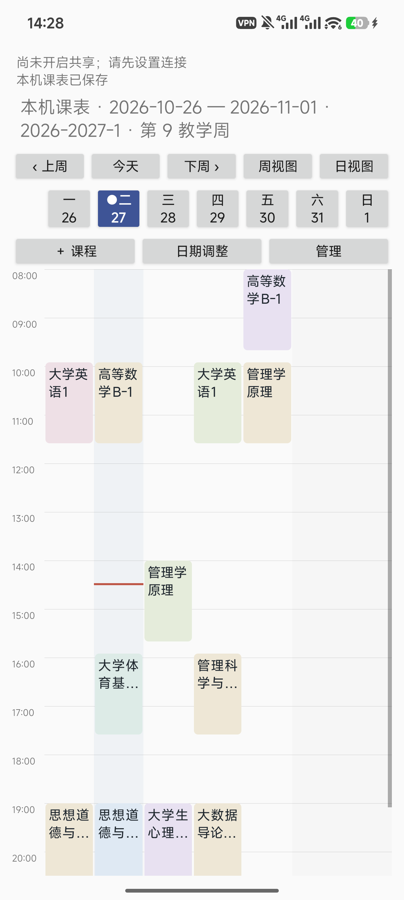 | 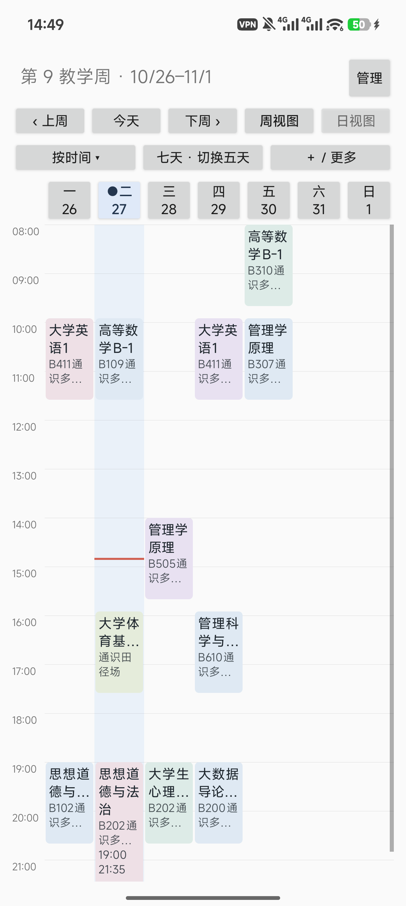 | 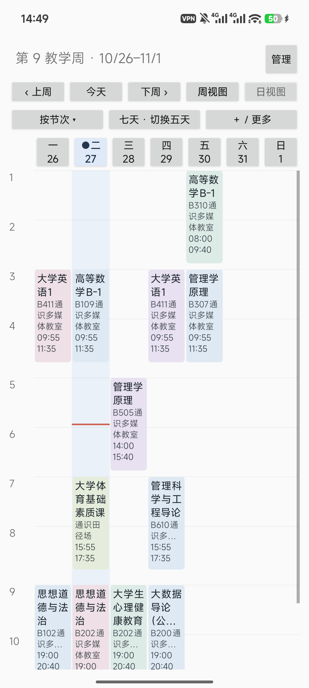 | 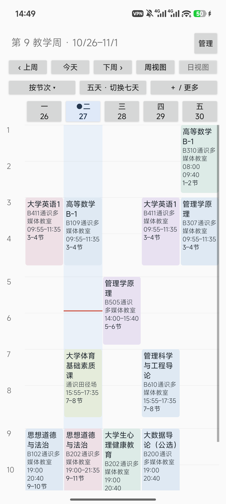 |

| **重构前 · PR61 旧版（仅供对照）**<br>深色 / 七天 | **重构后 · PR62 新版**<br>深色 / 七天 | **重构后 · PR62 新版**<br>深色 / 五天 |
| --- | --- | --- |
| 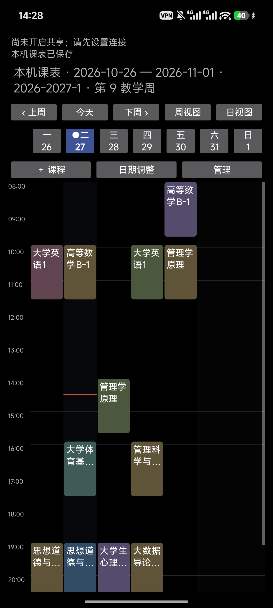 | 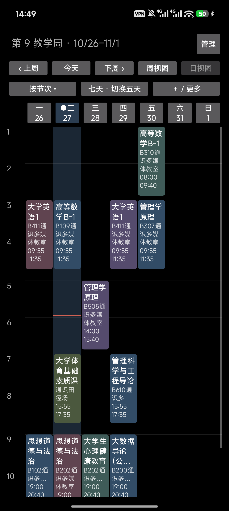 | 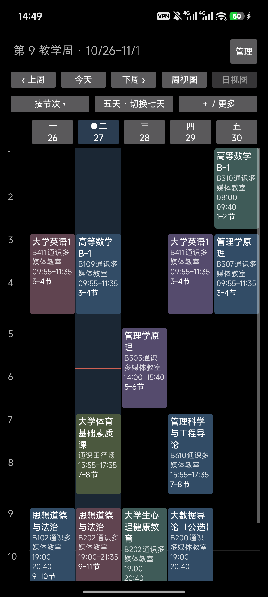 |

**重构后 · PR62 新版：小米 14 横屏 / 深色 / 节次七天。**

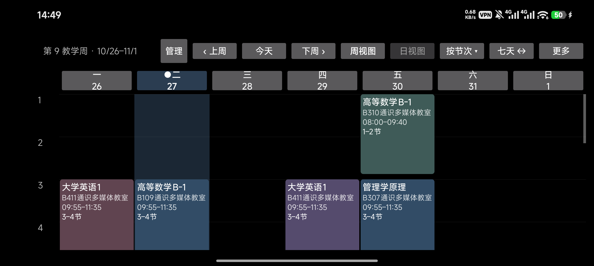

### Pixel 10 Pro 模拟器：1280×2856，API 37.2

| **重构前 · PR61 旧版（仅供对照）**<br>时间 / 七天 | **重构后 · PR62 新版**<br>时间 / 七天 | **重构后 · PR62 新版**<br>节次 / 七天 | **重构后 · PR62 新版**<br>节次 / 五天 |
| --- | --- | --- | --- |
| 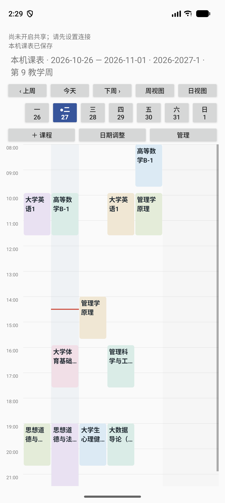 | 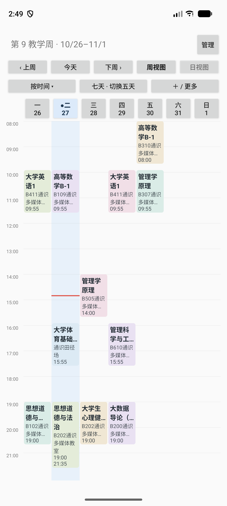 | 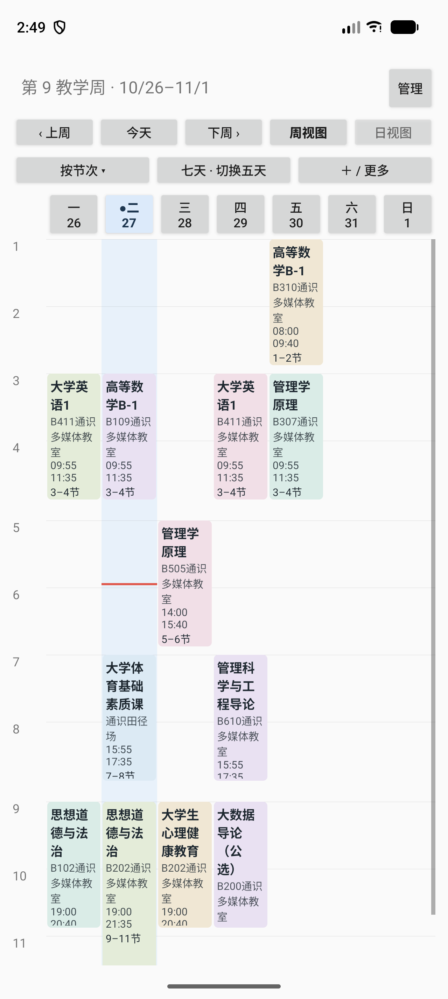 | 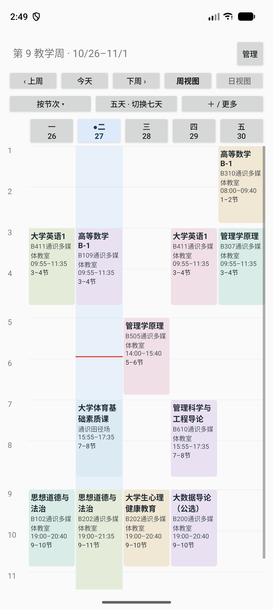 |

**重构后 · PR62 新版补充截图：** [Pixel 深色七天](pixel/period-seven-dark.png) · [深色五天](pixel/period-five-dark.png) · [横屏](pixel/period-landscape-dark.png)

**重构前 · PR61 旧版（仅供对照）：** [Pixel 旧版深色七天](pixel/baseline-time-seven-dark.png)

参考 WakeUp 截图的课程名称/地点信息密度与节次轴，不复制其作息时间、装饰或非本周课程。当前课程时间仍完全来自有效配置和现有投影。

## 首轮实际验证（本轮新增验证见追加记录）

- `:phone-app:testDebugUnitTest`：6 项通过，覆盖时间比例、每分钟映射/逆映射、周中阶段变更、午休、缺失/无效/重叠作息、时区边界、跨午夜及周边界原始身份。
- `:phone-app:assembleDebug`、`:phone-app:assembleX08eTest`、`:phone-app:assembleX08eTestAndroidTest`：构建通过；未修改版本或正式签名。
- Pixel：12 项受影响 UI 验证通过，覆盖 CSV/XLS/ICS、预览确认、编辑作用域/重置、日期调整、替换/删除来源、重开 Activity、旋转、偏移恢复、真实重叠与连续重叠、短课/跨午夜、配色、文字边界、新模式和真实分钟刷新。最后的滚动/横屏文字调整另按相关测试重跑。
- 小米 14：5 项专项通过，使用用户 CSV，覆盖模式/范围/重建、原始实例及阶段映射、卡片边界与配色、编辑/日期调整/来源替换删除、真实分钟定时；最终滚动锚点调整后再跑两项通过。
- MIX 2S：4 项重点测试通过，作为兼容性补充，不作为唯一视觉依据。
- 大字体：合成视图在 320 dp、1.6 倍字号下测量并断言可见文字处于卡片内；小米 14 实际 1.1 倍字号及两种现代屏幕比例有截图。未将合成测量描述为整机大字体手测。
- 红线额外等待下一次真实分钟边界，断言位置变化、同一卡片对象保留，Activity 转入停止状态后确认回调取消。未通过修改设备时钟制造结果。

构建命令：

```powershell
./gradlew.bat :phone-app:testDebugUnitTest :phone-app:assembleDebug
./gradlew.bat :phone-app:assembleX08eTest :phone-app:assembleX08eTestAndroidTest '-Pdormpanel.testBuildType=x08eTest'
```

UI 采用 `am instrument`；Pixel 使用 `directUi=true`，现代小米使用 `shellUi=true`，旧 MIUI 兼容启动使用既有 `pr35RootUi=true`。`userCsv=true` 允许专项测试读取隔离包 externalFiles 下的 `user-timetable.csv`，未提供时仍走仓库夹具的真实文件选择/确认流程。所有这些开关只存在于 androidTest。

### 已确认的基线失败

Pixel 原有完整测试中以下三项失败，在相同模拟器、独立 PR61 checkout 上重跑也同样失败；没有将它们计为 PASS，也没有为了本 PR 改动共享文件夹选择器或学期编辑业务：

- `browseFolderSelectAndCancelAreDraftOnly`：找不到测试预期的 `▸ room`。
- `folderErrorsCancellationAndLateResponses`：找不到测试预期的“没有子文件夹”。
- `missingCsvProfileCanBeConfiguredBeforeConfirmation`：API 37.2 的节次编辑框测得 457 px，原断言上限 451 px。

普通文件导入、已有学期导入及课程编辑由通过的对应测试覆盖；上述三个场景仍需单独跟进。

## 限制与未执行项

- 没有可用学期、任一可见日期缺少阶段、节次按时间顺序重叠，或学期时区与设备不同，整个网格安全退回时间模式并解释原因；不捏造节次。多个来源的学期不唯一时需在管理中明确选择。
- 七天窄屏及极短卡片仍可能省略次要字段；点击详情保留全部信息。五天模式不显示周末列，可切七天或在日视图查看任意日期。
- 参考图与新截图已人工对照；最新专项验收见追加记录。最终人工审查、批准与合并状态以 PR 页面为准。
- 未安排 X08E、fnOS、Sync v2/v3 全量、长时间 soak 或正式发布。没有修改这些业务模块；不以静态差异审查代替其实机验收。
