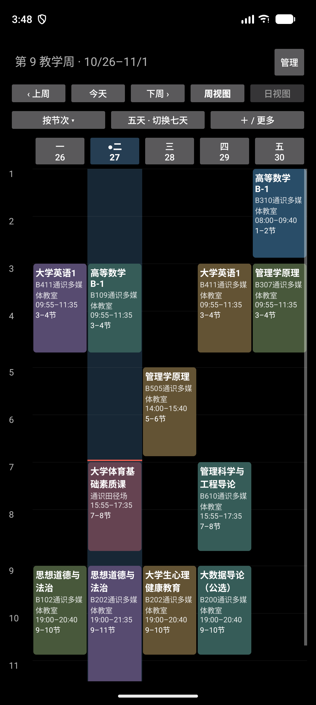
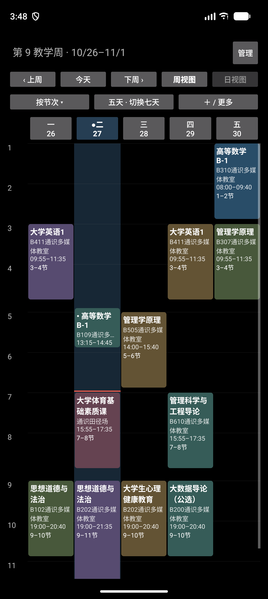
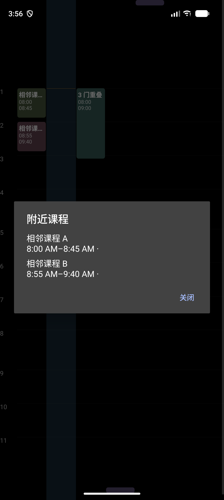
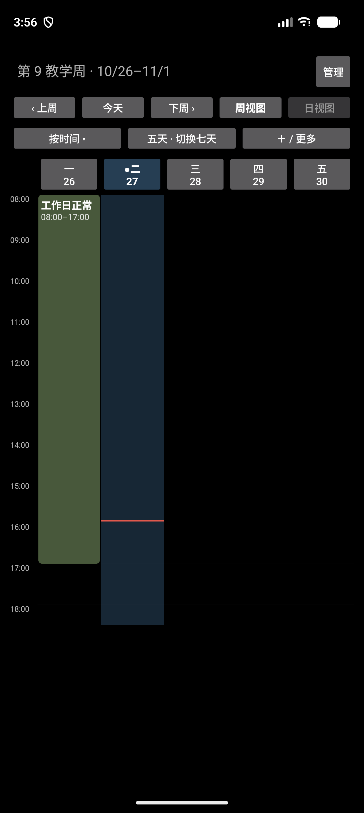
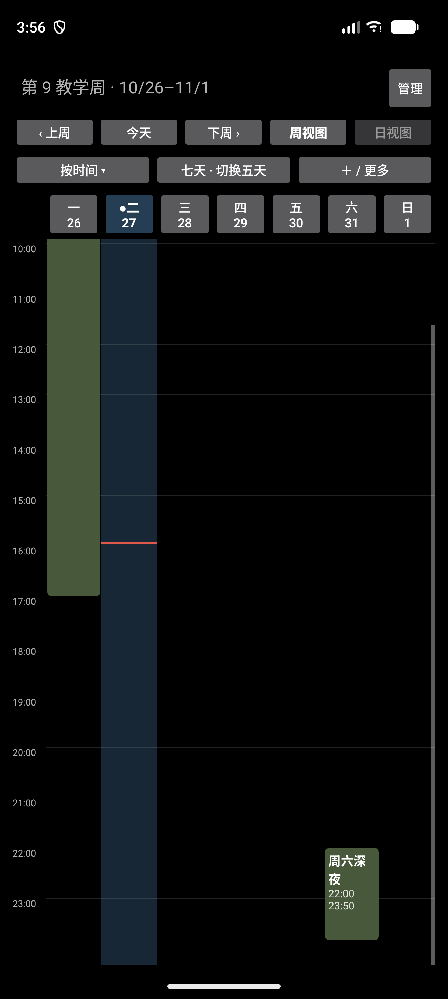

# PR62 审查修复与定向验收

2026-10-27，基于原 PR62 的 `78572537782ac7ba388f58994f20a680ed98aa60` 继续修改。未新建 PR，未操作日用课表、同步目录或正式 APK。

## 三处修复

1. **有效节次与原始标签分开。** 新增 Phone 只读展示辅助 `CoursePresentation`。只有 `linked=true`、所属来源的有效学期/日期阶段可用、所选节次均存在且时间顺序有效、实际起止 Instant 与作息精确相等时才显示当前节次。自定义时间即使恰好匹配作息也不推导节次。卡片和无障碍说明不再将旧标签作为当前节次；详情明确标为“原始导入节次（非当前节次）”，日视图也使用同一判定。原始导入记录未改写。短的自定义时间卡片优先保留真实起止时间，避免地点把唯一有效时间挤掉。
2. **本体命中优先，附近与重叠分开。** 真实分组只按原始 Instant 区间相交计算，不用扩大触控范围或分钟舍入制造重叠。命中本体优先打开对应组；空白处扩大 24dp 后只命中一组则打开该组，多组则按稳定时间顺序显示“附近课程”。单一真实重叠组才显示“重叠课程”，连续重叠组保留全部原始实例。移动超过 touch slop 或收到取消事件后不打开详情，原生 ScrollView 继续处理滚动。
3. **范围只取可见日期片段。** `WeekLayout.visibleRange` 先按五/七天过滤，再计算首末分钟。时间模式保留 08:00–18:00 默认区间，节次模式还保留有效配置的全部节次；周末 22:00 后课程不会拉长五天范围。真正可见的工作日晚间、周五跨午夜、上周日延续到周一的片段仍保留，切回七天仍使用同一投影对象。真实分钟滚动锚点机制不变。

变更限于 Phone 展示及测试，没有修改 ScheduleSource、ScheduleProjection、学期定义、Room schema/存储、Sync v2/v3、WebDAV、合并规则或版本号。

## 定向验证结果

所有 Android 验证在 Pixel 10 Pro 模拟器、API 37.2 的 `com.dormpanel.timetable.testbed` 中执行，沿用 UUID 隔离 Room 与学期配置。CSV 使用仓库湖北大学夹具；边界数据由测试构造，无日用数据。

- **JVM 12 项通过**：原有 6 项加新增 6 项。`CoursePresentationTest` 2 项验证关联/自定义/缺失或无效配置/精确时间与 academicDate 阶段；`WeekLayoutTest` 新增 3 项验证可见范围、跨周/跨午夜片段、本体优先/扩大命中、真实/连续重叠及秒级非重叠；`WeekAxisTest` 新增 1 项验证两种坐标下五/七天范围与配置节次、分钟锚点逆映射。
- **新增 Android 定向 3 项通过**：
  - `pr62ReviewCustomTimingKeepsSourceLabelButNeverShowsItAsCurrent`：CSV 导入，选中 3–4 节课程，经现有编辑器切自定义时间并设置 13:15–14:45，检查卡片实际时间可见且无旧节次、详情原始标签明确、重建与再次编辑仍为自定义、重置恢复 3–4 节、日期调整后有效节次匹配。断言原始导入记录保持相等。
  - `pr62ReviewCompressedGapUsesNearbyAndKeepsBodyAndCancelSemantics`：本体点击、8dp 压缩课间的“附近课程”、短课扩大命中、取消/移动不误开详情、原生 swipeUp 正常滚动、连续重叠三项独立选择、跨午夜两片段打开同一原始实例。
  - `pr62ReviewFiveDayRangeKeepsWeekdayFragmentsAndRestoresAnchor`：工作日 08:00–17:00 + 周六 22:00–23:50，在五/七天、时间/节次间切换，断言范围、数据不变、原始分钟锚点合理钳制、重建后偏好保留，并验证工作日 23:00 后课程不会被裁切。
- **相关 Android 回归 4 项通过**：既有 CSV 多模式/旋转/深浅色、合成阶段/短课/跨日/大字体边界、卡片文字与身份配色、真实分钟红线及后台取消。合计一轮 **7/7 PASS**；随后补充真实 swipeUp 和范围底部截图，相关两项再跑 **2/2 PASS**。
- **构建通过**：`:phone-app:assembleDebug`、`:phone-app:assembleX08eTest`、`:phone-app:assembleX08eTestAndroidTest`。JVM 与 UI 结果摘录见 [results.txt](results.txt)。

本轮没有重复多设备矩阵、PR58 RC、X08E/fnOS、同步增长或 soak。此前三个 Pixel 基线失败保留在上级记录，未重跑、未计为通过，也未修改其断言。

## 本轮修复后的截图

**以下全部为本轮修复后的 PR62，不含旧版本截图。** 第一组只是在同一隔离数据集中比较“仍关联节次”和“改为自定义时间”两种课程状态；不是两个代码版本。截图保留设备真实时间，不修改系统时钟。

| 修复后：仍关联作息，当前 3–4 节 | 修复后：自定义 13:15–14:45，无旧 3–4 节 |
| --- | --- |
|  |  |

压缩课间：A 为 08:00–08:45，B 为 08:55–09:40，实际不重叠。点击间隔显示“附近课程”，均可独立选择。此图把合成数据直接挂载到真实 PhoneWeekView 验证命中，不含 Activity 导航区：

同一组合成课程、同一教学周，分别滚到网格底部：时间模式五天保留默认至 18:00，七天保留周六至 23:50。节次模式下五天还保留配置中的晚间节次至 21:35，该边界通过自动化断言验证。

| 修复后：五天，隐藏周末不拉长范围 | 修复后：七天，周六深夜课程完整保留 |
| --- | --- |
|  |  |

## 审查与限制

工程定向验收已通过，继续在原 PR62 进入人工审查，不自动合并、打 tag 或发布。人工批准和当前 HEAD 以 PR 页面为准；本轮推送前读取到正式 Review 数为 0、行内线程数为 0，不能将 Ready for Review 当作已获批准。

无法确认有效节次时采取保守策略：只显示真实时间，详情保留原始标签；不根据近似时间自动猜测节次。极短卡片仍可能省略名称或地点，但原始实例详情入口继续可达。
