# PR63：X08E 课表显示设置与验收

基于 main / PR62 合并提交 `8e550696664358f1dcb47c387a7f7120a28eba4b`。验收日期：2026-10-27。

## 设置说明

进入完整课表，点击右上角「显示设置」。布局可选经典列表、实际时间、按节次；「按课程配色」和「优化信息排版」是两个独立开关。点击保存后立即生效，取消不改变当前设置。

没有显示偏好的既有安装默认采用**经典列表、经典单色、经典排版**。切回经典列表并取消两个勾选即可恢复经典风格。设置仅写入本机 `x08e_schedule_display` SharedPreferences，不进入课表数据库、学期配置或同步数据。损坏或未知的布局值回退为经典列表，保留独立开关。

经典模式保留七个日期列及其独立滚动、课程详情和编辑、日期调整、周次导航及原有管理入口。时间网格使用一个纵向滚动容器，日期标题和「查看 N 门」入口固定可见；管理中的添加、导入、接收及来源/同步仍调用原入口。

## 展示规则

- 实际时间采用最终 `ClassOccurrence.start/end`。跨午夜切片到实际日期，点击仍引用原始 occurrence；不以原始导入时间重新定位课程。
- 节次模式校验本周涉及来源的配置、时区、七天生效阶段及节次先后关系；只有能构造一致的节次表时才压缩课间。自定义时间及节次外课程继续按同一可逆时间映射显示。缺失/混合作息明确提示并回退到实际时间，不隐藏课程。纯本地课程没有可靠的学期关联时同样回退，不猜测配置。
- 当前节次必须与有效关联作息及 occurrence 的实际起止时刻一致。详情中会区分当前节次与原始导入节次。
- 重叠按精确 Instant 判断，课程各自保持真实起止坐标并分配可复用的并排位置。点击独立卡片直接进入该卡片对应的原始 occurrence 详情；日期下方的固定列表可选择短课程、午夜课程及拥挤课程。只有当天列表确有多门课程时才弹出选择框，单门直接进入详情。空白位置没有扩大后的课程点击区域。
- 配色使用 `sourceId + seriesId` 的稳定散列，与日期、课程名称和排序无关；六种低饱和色允许不同课程同色。卡片仍保留文字身份，并通过 `AppearanceAware` 自行响应主题，避免全局 Button tint 覆盖。
- 优化排版按空间展示名称、原始地点、有效时间/节次及必要的已修改/补课标记。正常课程不重复标记 Imported。空间不足时明确省略次要文字，完整信息可在详情查看；不拆分学校地点命名。
- 今天列和标题高亮；当前时间线仅在真实今天显示。可见且位于当前周时每分钟只更新覆盖层；隐藏/脱离窗口时停止回调。主题切换更新现有卡片，时钟更新不重建课程视图。
- ViewModel 持有轻量视口状态：经典模式保留各列偏移；网格保存视口顶部对应的实际时间，切换布局或节次回退后重新映射，避免像素偏移把页面带到凌晨。冷启动默认定位上午 08:00 附近，仍可滚到午夜及晚间。

## 环境与证据

使用本机 `X08E` AVD：Android 9 / API 28、1280×800、160 dpi、横屏，串号 `emulator-5580`。只安装 `com.dormpanel.app.testbed` 及其 instrumentation APK；未安装到连接的物理设备。展示使用固定时钟（2026-10-26 起的一周）和独立合成课程，包含两节连堂、1 分钟短课、真实重叠、跨午夜及作息阶段变化；业务回归使用仓库既有隔离数据。

| 检查 | 实际结果 | 证据 |
| --- | --- | --- |
| X08E 测试 App、AndroidTest APK 构建 | PASS | [构建与几何测试日志](build-and-geometry.txt)、[最终构建](final-build.txt) |
| 新增几何 JVM 测试 | 6/6 PASS；含真实时间、午夜切片、秒级相邻/重叠、分配并排位置、节次压缩及反向映射、混合作息/时区回退、当前节次及稳定配色 | [JUnit XML](results/TEST-com.dormpanel.app.schedule.X08eWeekGeometryTest.xml) |
| 既有核心课表 JVM 测试 | 34/34 PASS | [ScheduleTest](results/TEST-com.dormpanel.app.schedule.ScheduleTest.xml) 14、[ScheduleOverridesTest](results/TEST-com.dormpanel.app.schedule.ScheduleOverridesTest.xml) 17、[ClassEditSessionTest](results/TEST-com.dormpanel.app.schedule.ClassEditSessionTest.xml) 3 |
| App JVM 全量测试 | **205/206 通过，1 项失败** | `WebDavClientTest.lastModifiedFallbackAndTimeout` 第 139 行；单项重跑同样失败。既有测试要求请求阶段超时消息含 `timed out`，当前未修改的 WebDavClient 请求异常统一映射为 `Network unavailable or TLS certificate rejected.`。本 PR 未更改网络实现或降低该断言；未声称全量 PASS。 |
| 既有课表交互/重启及第一轮显示 UI | 10/10 PASS | [Android 回归日志](android-test-run.txt)：课程编辑、日期调整、周次/页面往返、主题、事件及隔离重启 |
| 既有本机读取失败 UI | 2/2 PASS | [读取失败回归](read-failure-test-run.txt)：已有数据保留、写入禁用、重读恢复及不触发启动同步 |
| 最终显示 UI 专项 | 4/4 PASS | [显示专项日志](display-test-run.txt)：12 种配置组合均切换深浅色；设置保存；滚动/页面重建/刷新；时钟仅更新覆盖层；非当前周隐藏红线；短课详情、重叠选择、日期调整、停课、混合作息回退及时间视口保持 |
| 完整详情收尾回归 | 1/1 PASS | [详情回归](detail-test-run.txt)：最终详情滚动内容包含完整课程名称；再次验证短课时间、重叠选择、日期调整、停课及回退视口 |
| 模拟触摸滚动专项 | 1/1 PASS，并已纳入最终显示专项再次通过 | [滚动日志](scroll-test-run.txt)、[最终显示专项](display-test-run.txt)：Espresso swipeUp、数据刷新及重新进入保留滚动与教学周 |
| 显示偏好跨进程恢复 | seed/verify 各 1/1 PASS | [写入](restart-seed.txt)、[force-stop 后读取](restart-verify.txt)，使用 UUID 命名的独立 UI 偏好文件 |

执行命令（PowerShell，JDK 使用 Android Studio JBR；带点的 Gradle 属性必须加引号）：

```powershell
./gradlew.bat :app:assembleX08eTest :app:assembleX08eTestAndroidTest :app:testX08eTestUnitTest '-Pdormpanel.testBuildType=x08eTest' --tests com.dormpanel.app.schedule.X08eWeekGeometryTest
./gradlew.bat :schedule-core:testDebugUnitTest --tests com.dormpanel.app.schedule.ScheduleTest --tests com.dormpanel.app.schedule.ScheduleOverridesTest --tests com.dormpanel.app.schedule.ClassEditSessionTest
./gradlew.bat :app:testX08eTestUnitTest '-Pdormpanel.testBuildType=x08eTest'
adb -s emulator-5580 shell am instrument -w -r -e class com.dormpanel.app.schedule.X08eScheduleDisplayTest com.dormpanel.app.testbed.test/androidx.test.runner.AndroidJUnitRunner
```

跨进程检查用同一 UUID 分别运行 `X08eDisplayRestartTest` 的 `displayPhase=seed`、`adb -s emulator-5580 shell am force-stop com.dormpanel.app.testbed`、`displayPhase=verify`。该测试仅拥有自己的可丢弃 UI 偏好文件，不访问真实课表或凭据。

## UI 对照截图

以下均为 API 28 模拟器原始 1280×800 截图。正常课程显示真实课程名称及地点；截图中的课程、来源与固定“今天”均为隔离合成数据。经典/时间对照采用相同的深色主题。

| 经典列表，单色与课程配色 | 优化信息排版 |
| --- | --- |
| 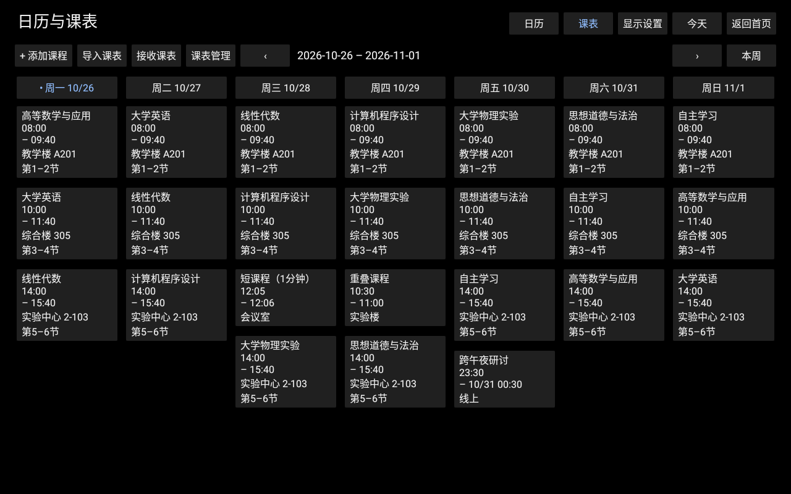 | 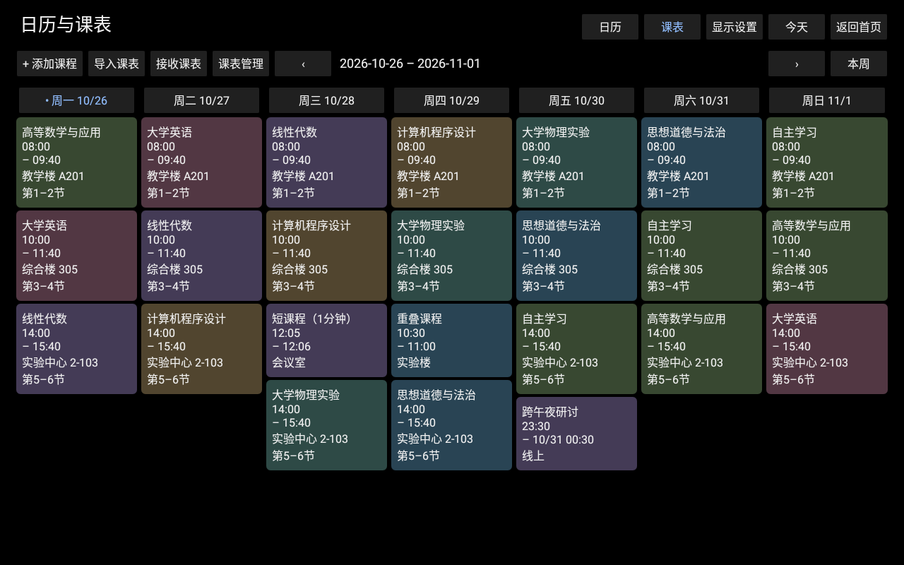 |
|  | 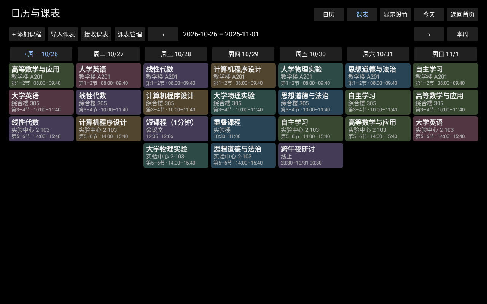 |

| 实际时间，经典排版 | 实际时间，优化排版 |
| --- | --- |
| 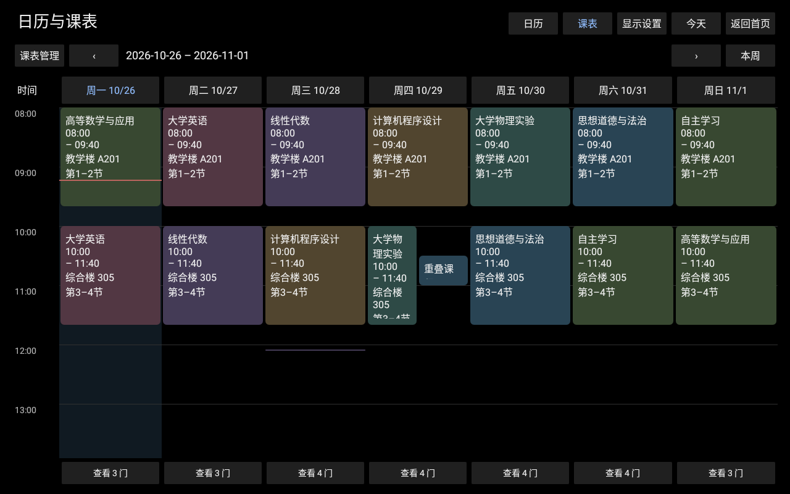 | 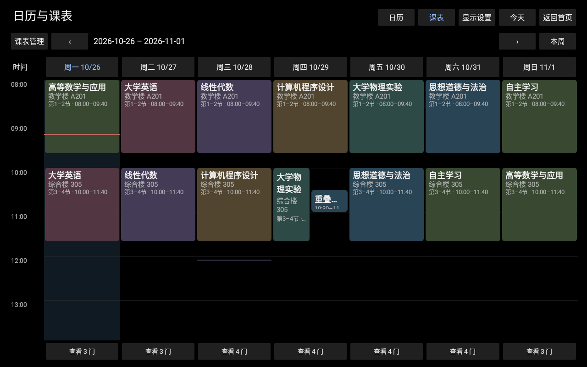 |

| 节次，经典排版 | 节次，优化排版 |
| --- | --- |
| 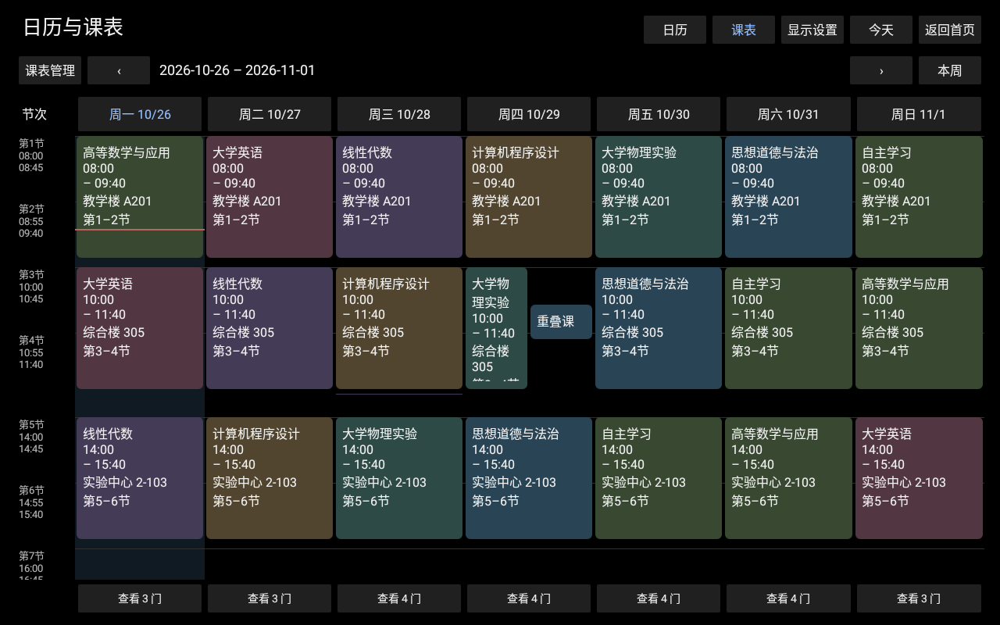 | 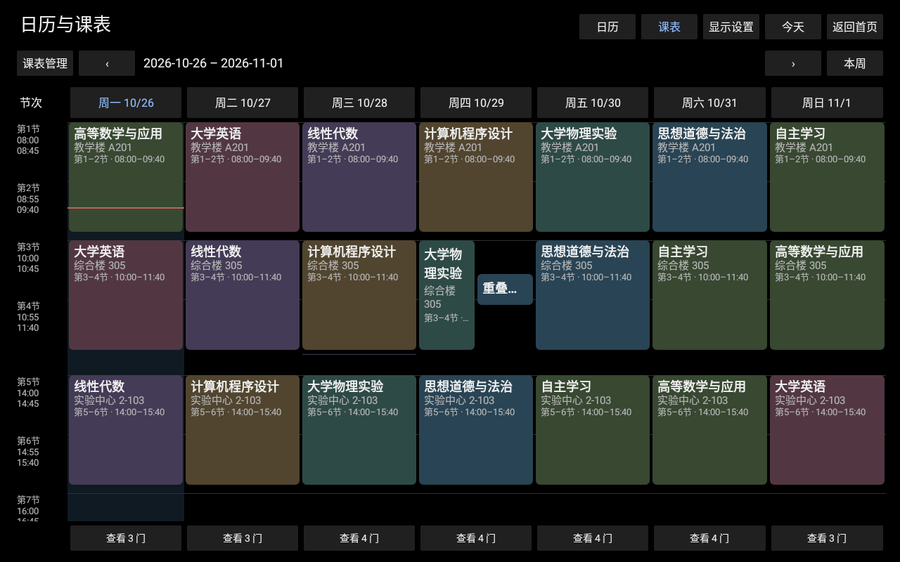 |

| 节次深色 | 节次浅色 |
| --- | --- |
|  | 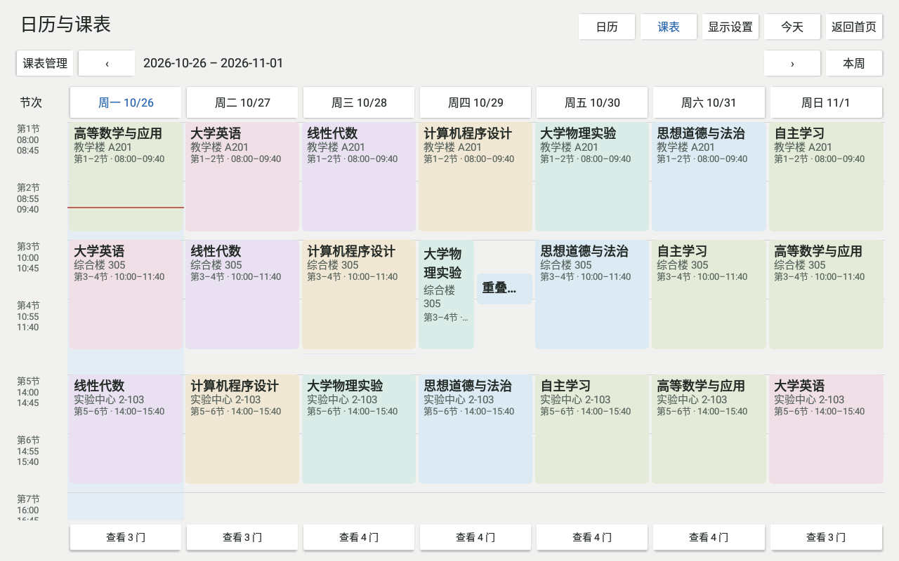 |

| 显示设置 | 首轮审查证据与作息回退 |
| --- | --- |
| 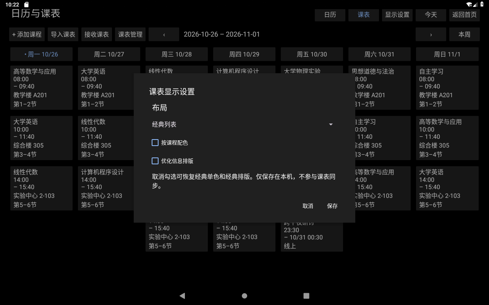 | 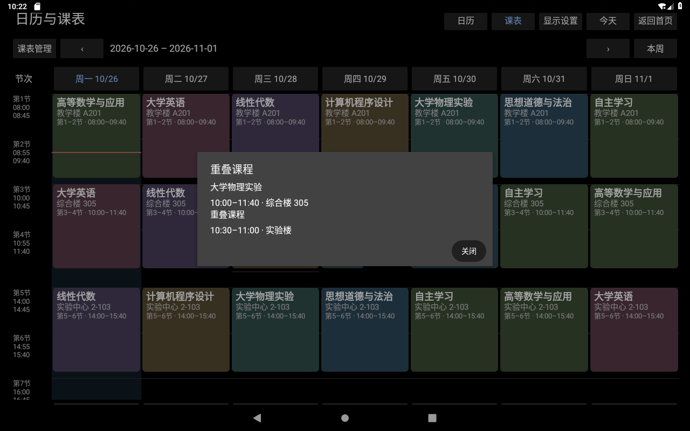 |
| 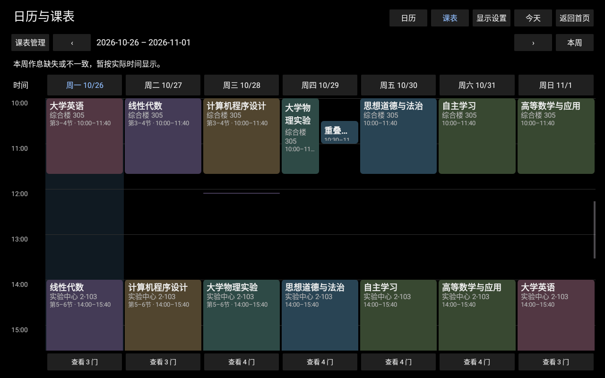 | 回退仍展示课程，并保持视口对应的实际时间。 |

## 剩余限制

- 未在真实 X08E 验收触摸、亮度及长时间运行，未声称实机 PASS。未运行 Phone、fnOS 或 Sync v3 完整专项，也未进行四小时 soak。
- 非标准短课和密集重叠卡片可能只容纳简略文字；固定的当天课程入口及详情保留完整访问。不同有效作息不能共用一套诚实的节次刻度时，采用明确的实际时间回退。
- App 全量 JVM 的既有 WebDAV 文案断言仍失败，保留上方原始失败记录。本次未改相关代码、不重跑全量，也不把该既有失败归因于此次 UI 修复；未声称全量通过。按本次交付要求，该项与实机未验证项不自动阻塞转为 Ready for Review。
- 未修改课程模型、数据库表、导入原文、作息定义、编辑/合并/同步语义、Phone 代码或正式版本号；未合并、发布 Release 或升级日用设备。

## 合并前收尾：独立卡片点击与经典兼容

针对审查 HEAD `61c3e396031acbf0cb0de330b2c2221b3abb671b` 的局部修复：原先虽已绘制独立重叠卡片，点击仍把整个 group 交给选择框；现在每张卡片直接调用 `detail(segment.item)`。当天列表继续持有完整原始 occurrence，只有多候选列表才要求选择。精确 Instant 分组、并排位置、时间轴、显示偏好及业务写入路径均未修改。经典 Button 的无障碍文本、分层卡片的无障碍描述与实际点击目标都指向各自课程。

### 经典兼容契约与 PR62 对照

兼容配置固定为 `CLASSIC + colors=false + hierarchy=false`，兼容指布局和操作保持熟悉，并非逐字复刻旧标签。对照 `8e550696664358f1dcb47c387a7f7120a28eba4b` 的 `SchedulePageView.timetable()`：

| 必须保留的行为 | 对照与验证 |
| --- | --- |
| 七天并列、等权列与七列独立纵向滚动 | 继续使用七个竖向 LinearLayout、每列自己的 ScrollView、相同 3dp 列内边距；滑动第一列不改变其他六列。整数布局可有 1px 取整差。 |
| 日期及时间顺序、课程不遗漏 | 沿用同一 `ScheduleProjection.week` 结果和日期过滤；用乱序输入的 24 门追加本地课与原有导入课核对实际卡片顺序和数量。 |
| 单色、经典文字结构与深浅色 | 继续用 Button、16sp、最多七行、名称/起止时间/地点/节次纵向文本与同一 PanelPalette.surface；两个主题均检查单色 tint。4dp 卡片间距只是可读性微调，不改变触控入口。 |
| 详情、编辑、日期调整和周次导航 | 继续传递原始 occurrence 给既有 ScheduleEditors；实际打开本周编辑并核对名称；点击日期调整、下一周和本周；既有 scoped-edit 保存/恢复回归通过。 |
| 无偏好默认与随时切回 | 清空 testbed 的显示偏好后直接创建页面，得到经典单色/经典排版及七列；通过设置切到彩色分层时间模式，再切回三个经典值并核对保存结果。 |
| 原有管理操作 | 添加、导入、接收、来源/同步入口及权限判断沿用 PR62；只新增集中显示设置入口和设备语言文案。 |

允许的文字改善：显示最终生效起止时间（跨日注明日期）、仅展示经验证的当前节次、取消正常课程重复的 Imported、采用中文设备文案。地点不拆分；教师、备注、来源及原始说明保留在完整详情中。上述对照没有发现需要再改产品布局或业务入口的操作退化，因此此次生产代码只修复网格点击。

### 本次定向验证

仍使用 API 28、1280×800、160dpi 的 `emulator-5580` 与 testbed/隔离数据；未安装到物理 X08E。

- X08E App/AndroidTest 构建通过：[构建与 JVM](premerge-build.txt)、[补充 UI 测试构建](premerge-ui-build.txt)。几何 JVM 6/6 PASS：[JUnit XML](results/premerge-X08eWeekGeometryTest.xml)。
- `individualCardsOpenTheirOwnDetailsForTwoThreeAndAdjacentCourses`：在实际时间和节次两种网格，覆盖双课重叠、三课重叠及端点相接的非重叠课程。通过 Espresso 真实点击，核对目标名称、起止时间、地点、教师、备注、来源及原始说明，并进入所选 B 的本周编辑核对字段。经典单色与彩色分层均覆盖所有目标，另两种配色/排版组合覆盖 A/B；还点击真实时间及压缩节次中的课间空白，确认不打开详情或选择框。
- `fixedDayListsRetainShortSubminuteAndBothMidnightSlices`：一分钟、十秒课程及跨午夜课程在前后两天的固定列表均能进入对应详情，未改原始导入记录。
- `classicCompatibilityDefaultsIndependentScrollingAndOperations`：验证上方经典兼容契约的默认值、顺序、独立滚动、两主题单色、详情与编辑、日期调整、周次导航以及设置往返。
- 复用 `shortOverlapFallbackAndDateAdjustmentRemainAccessible` 与偏好默认/损坏值回退测试；已有 `localClassDetailDayAdjustmentAndScopedEdit` 再次完成实际保存、覆盖与恢复验证。
- [首轮记录](premerge-ui-initial.txt)：6 项中的 5 项通过；经典测试起初错误要求所有等权列的整数宽度完全相等，遇到正常的 1px 取整差后失败。已将该断言修正为至多 1px，并保留列数、横向排列、独立父容器和实际滚动断言。[修正后的经典及卡片定向记录](premerge-ui.txt)：最终 2/2 PASS，包含新增的实际/压缩课间空白点击断言；本轮覆盖的 6 项测试均已有通过记录。

此前 12 种组合的完整视觉、跨进程偏好、深浅色和核心课表 34 项验收继续复用，没有机械重复全套测试。未修改 WebDAV，保留前述 205/206 与超时文案断言失败；未验证的真实设备触摸、亮度与长期运行继续列为限制。

| 审查时点击独立卡片仍弹选择框（历史） | 修复后点击 B 直接显示 B 的完整详情 |
| --- | --- |
|  | 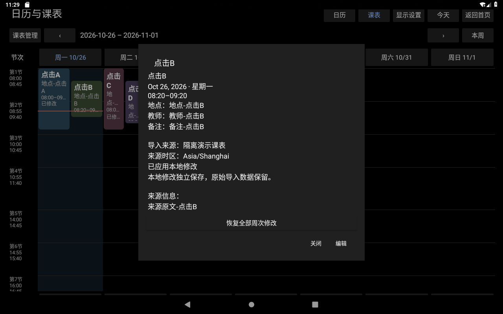 |
