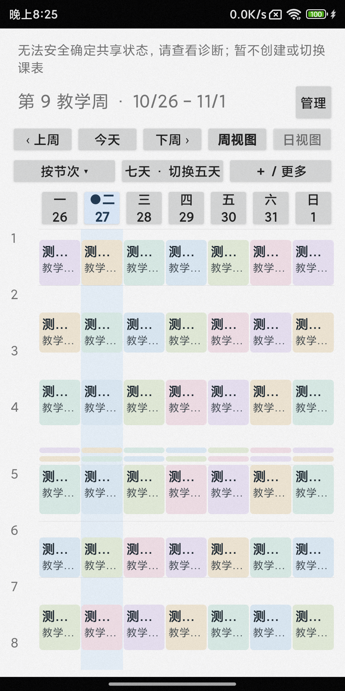
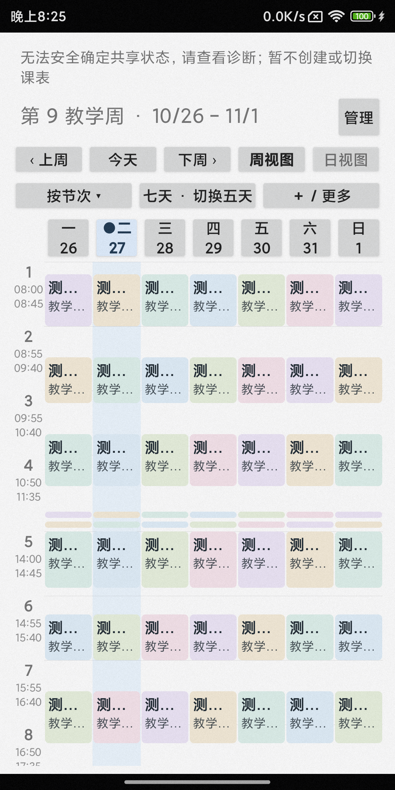

# PR64：Android 课表横划与 Phone 节次时间轴

> 当前实现与最新验收见 [PR64 收尾：真实相邻页预览、今天背景核查、Home 触控区域](follow-up/README.md)。下文保留 `3620ba4` 初版验收档案，其中 24% 限幅及淡入/淡出动画已被真实双页预览替换；原测试记录与节次轴对照仍保留。

> X08E 首次预览性能后续见[性能采样与未完成结论](performance/README.md)：已降低集中阻塞，尚未达到正常触摸帧预算，不能视为性能验收通过。

基于 PR63 合并提交 `162e10f9953156ec77d5f424fb8fcb0000dfe595`，验收日期 2026-10-27。没有修改发布版本、课程写入模型、Sync v2/v3、Room schema 或 WebDAV 实现。

## 使用

- Phone：课表「管理 → 课表显示设置 → 横划切换日期 → 保存」。日视图左划后一天、右划前一天；周视图左划下一周、右划上一周，保留选中星期、五/七天与时间轴模式。日视图按钮同步改为「前一天 / 后一天」，今天仍回真实今天。
- X08E：完整课表「显示设置 → 横划切换周次 → 保存」。经典列表、实际时间及节次网格均可左右翻周。日历和其他页面的导航不变。
- 两端开关独立、默认关闭，仅保存本机显示偏好。取消设置不保存；关闭后直接沿用子视图原事件流。原导航按钮继续可点击。

## 手势、动画与状态

`schedule-core` 的 `TimetableSwipeLayout` 只包住日期标题及课表内容；固定工具栏、设置和详情窗口不在手势区域。它不认识课程数据或应用页面。超过系统 touch slop 且水平位移大于垂直位移的 1.7 倍才锁定；一旦确认竖向/斜向滚动，本次不再转成横划。接管时向原触摸目标发送 CANCEL，保留未接管时的 ScrollView、课程卡片和短课附近命中路径。

内容跟随水平位移，上限为容器宽度的 24%。距离达到 `max(23% 宽度, 4×slop)`，或至少移动 `3×slop` 且同向横向速度达到 `max(系统 fling 下限, 900dp/s)` 时提交；松手时仍须水平占优。多触点、CANCEL、未达阈值不翻页。没有独立的 fling 回调重复提交。

回弹 180ms；提交采用同方向出场 120ms、相邻内容入场 80ms，总标称 200ms。只做 View translation/alpha，不截图、不创建重复课程预览、不缓存 Bitmap。出场完成后才修改日期并重建投影，入场页可被新的 DOWN 立即接住；出场阶段屏蔽重复事件流。系统关闭动画时直接切换；属性动画遵守系统时长倍率。

刷新、模式切换、失去窗口焦点、隐藏、离开页面及销毁都会取消未完成动作并复位位移/透明度。入场回调带本地动作代次，避免尚未执行的旧回调覆盖新横划；同一 UI 轮次立即接住入场再提交有专门回归断言。Phone 在 onPause 取消动画后保存日期、模式和滚动；周视图沿用真实分钟锚点，日视图沿用阅读偏移。X08E 沿用 `ScheduleSession` 和 `ScheduleViewport`，经典七列独立滚动，网格沿用实际时间锚点。可滚范围不足时仍按原行为夹紧位置。

## 32dp 节次轴

保留 32dp 宽度和每节 56dp 高度。数字 12sp 加粗，起止时间 9sp、较低文字权重，三行显示；大字体下分别限制可视放大至 1.3/1.2 倍，完整节次和时间仍在 TalkBack 内容描述中。实际时间轴继续显示小时刻度。

标签来自当前有效 profile 的逐日 phase 和 PeriodTime。比较所有可见日期的真实节次号及起止时间；一周可见日期作息不一致时，明确提示并回退实际时间，不用周一时间代表全周。缺失、重叠、时区不符及秒级节次时间也安全回退，不隐藏课程。跨午夜、短课和重叠分组继续使用原投影和详情对象。

以下为 MIX 2S 物理设备同一合成课表、同一视口的对照。**改进前由 instrumentation 在同一投影中精确复现 PR63 的数字轴构造；并非旧 APK 截图。改进后为本次实际实现。** 上方共享状态提示来自不支持同步的隔离 Fake Store，没有连接真实共享课表。

| 原数字轴复现 | 本次节次与起止时间 |
| --- | --- |
|  |  |

[Phone 深色五天截图](screenshots/phone-physical-axis-dark-five.png)，[模拟器改进前](screenshots/phone-axis-before.png)，[模拟器改进后](screenshots/phone-axis-after.png)。

## 实测环境与结果

仅安装独立 `.testbed` 及 instrumentation 包，没有覆盖日用 Phone/X08E App。Phone 新测试用拒绝所有写入的 Fake Store、随机学期偏好命名空间；X08E 用既有隔离内存数据库和合成课表。已有 Phone 回归使用独立测试 Room/导入样例。未访问真实课表、WebDAV、凭据或备份。

- 物理 Phone：MIX 2S，Android 13 / API 33，1080×2160；物理 X08E：Android 9 / API 28，1280×800。
- 模拟器：Pixel 10 Pro / API 37、1280×2856；X08E AVD / API 28、1280×800。
- 触摸验证包括直接 MotionEvent 分发和 Espresso 经系统注入的慢拖。不是只测纯函数，也不是人工手指主观流畅度评分。

| 验证 | 实际结果与证据 |
| --- | --- |
| 两端 testbed App / AndroidTest 构建 | PASS，[构建日志](build.txt)；新增重启测试另有[构建日志](restart-build.txt) |
| Phone JVM | 13/13 PASS：WeekAxis 5、WeekLayout 6、CoursePresentation 2；[XML](results/) |
| X08E 几何与原全局导航 JVM | 12/12 PASS：WeekGeometry 6、NavigationRouter 4、TopEdgeSwipeGate 2；[日志](app-jvm.txt)、[XML](results/) |
| Phone 物理设备最终专项 | 5/5 PASS，[记录](phone-physical.txt)：跨年/跨月/跨周日导航、按钮、默认关闭与 UI 开启、4 种周显示组合、双向导航、分钟锚点、慢短拖回弹、fling、竖向滚动、斜向、多指、CANCEL、刷新打断、重建；真实课程起手取消点击、附近短课、重叠选择；字体 1.0/1.3/1.6 的宽高测量、深浅色、混合作息回退 |
| X08E 物理设备最终专项 | 4/4 PASS，[记录](x08e-physical.txt)：三布局双向/取消/快速切换、七列独立滚动及统一网格滚动、分钟锚点、刷新/焦点打断、开关和设置恢复、日历；实际 MainActivity 的课表横划不触发全局切页，Home 与首页左划仍有效 |
| 系统动画倍率为 0 | Phone 5/5、X08E 2/2 PASS，[Phone](phone-scale-zero.txt)、[X08E](x08e-scale-zero.txt)；仅改模拟器设置，测试后恢复 |
| Phone PR62 定向回归 | 5/5 PASS，[记录](phone-regression.txt)：真实 CSV 的五/七天及双轴/旋转/重建、短课附近点击与取消、跨午夜原始详情、混合作息安全回退 |
| X08E 既有显示回归 | 既有 7 项通过；首轮共 9 项中新增手势项因测试视口已到底而失败，修正测试初始滚动位置后专项通过。[首轮完整记录](x08e-display-initial.txt)保留失败，未声称该轮整体 PASS |
| X08E 原页面回归 | 首轮 6/7，首项 `NoActivityResumedException`；唤醒后该项单独重跑 1/1 PASS。[首轮](x08e-main-initial.txt)、[重跑](x08e-main-retry.txt)。包含 CRUD、日期调整、主题、Home/模式往返与事件过期 |
| 跨进程显示偏好 | Phone 实际 Activity 冷启动验证日期、五天/节次、横划开关及非零滚动锚点；X08E 使用 UUID 独立偏好文件，含新开关。均在 seed 与 verify 之间 force-stop；[Phone 写入](phone-restart-seed.txt)/[读取](phone-restart-verify.txt)，[X08E 写入](x08e-restart-seed.txt)/[读取](x08e-restart-verify.txt) |

Phone 首轮实机因休眠出现窗口/动画取消，1.3 倍字体还发现时间文字超宽 1px；测试窗口改为保持亮屏，并收紧次要时间文字放大上限后，最终 5/5 通过。模拟器早期回归使用 UTC 导致中国时区样例回退；改为 Asia/Shanghai 后 5/5 通过，结束后恢复原模拟器时区。

## 动画证据和验证边界

- [Phone 物理设备短录像](videos/phone-physical.mp4)：真实系统触摸注入，包含左右切换与短拖回弹，已去除设备桌面片段。
- [X08E API 28 模拟器录像](videos/x08e-api28-emulator.mp4)：经典、实际时间、节次三布局的方向与回弹。物理 X08E 的原生注入断言通过，但 `screenrecord` 返回 `Encoder failed (err=-38)`，因此没有把模拟器视频标为物理录像。
- 抽帧检查确认固定工具栏保留、内容和日期标题同向移动、没有相邻假课程或整页闪空。动画时长是属性动画标称值；未进行物理设备逐帧时延、长期 CPU 或峰值内存基准，不宣称稳定 60fps。TalkBack 保留按钮和完整描述，尚未做人工朗读流程验收；小爱、Mesh 和系统闹钟未做完整功能验收。
- 没有运行 Sync v3 全套协议、fnOS 发布验收、增长测试或 soak；本次不涉及这些路径。没有合并、Tag、Release 或日用设备升级。

## 复现入口

```powershell
./gradlew.bat :phone-app:assembleX08eTest :phone-app:assembleX08eTestAndroidTest :app:assembleX08eTest :app:assembleX08eTestAndroidTest :phone-app:testX08eTestUnitTest '-Pdormpanel.testBuildType=x08eTest'
./gradlew.bat :app:testX08eTestUnitTest '-Pdormpanel.testBuildType=x08eTest' --tests '*X08eWeekGeometryTest' --tests '*NavigationRouterTest' --tests '*TopEdgeSwipeGateTest'
adb -s <Phone测试设备> shell am instrument -w -r -e class com.dormpanel.phone.TimetableSwipeTest com.dormpanel.timetable.testbed.test/androidx.test.runner.AndroidJUnitRunner
adb -s <X08E测试设备> shell am instrument -w -r -e class com.dormpanel.app.schedule.X08eScheduleDisplayTest#pr64SwipeAllLayoutsDirectionCancelScrollAndRefresh,com.dormpanel.app.schedule.X08eScheduleDisplayTest#pr64SettingsPersistAndDisableCancelsMotion,com.dormpanel.app.schedule.X08eScheduleDisplayTest#pr64NativeTouchAnimationAcrossLayouts,com.dormpanel.app.ScheduleAndroidTest#pr64ActualPageSwipesNeverTriggerGlobalNavigationAndHomeStillWorks com.dormpanel.app.testbed.test/androidx.test.runner.AndroidJUnitRunner
```

先安装相应 testbed 和 AndroidTest APK；不要改为日用包名。重启测试分别传 `displayPhase=seed/verify`；X08E 两次还需使用同一个 UUID `displayRun`。动画倍率 0 的验证仅在可丢弃模拟器执行并恢复设置。
