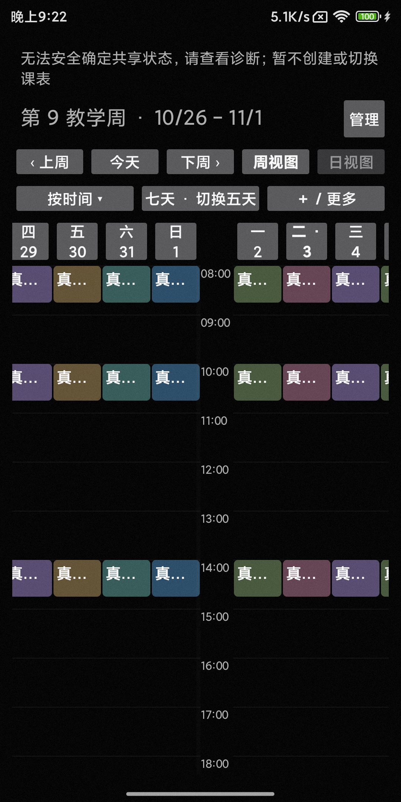
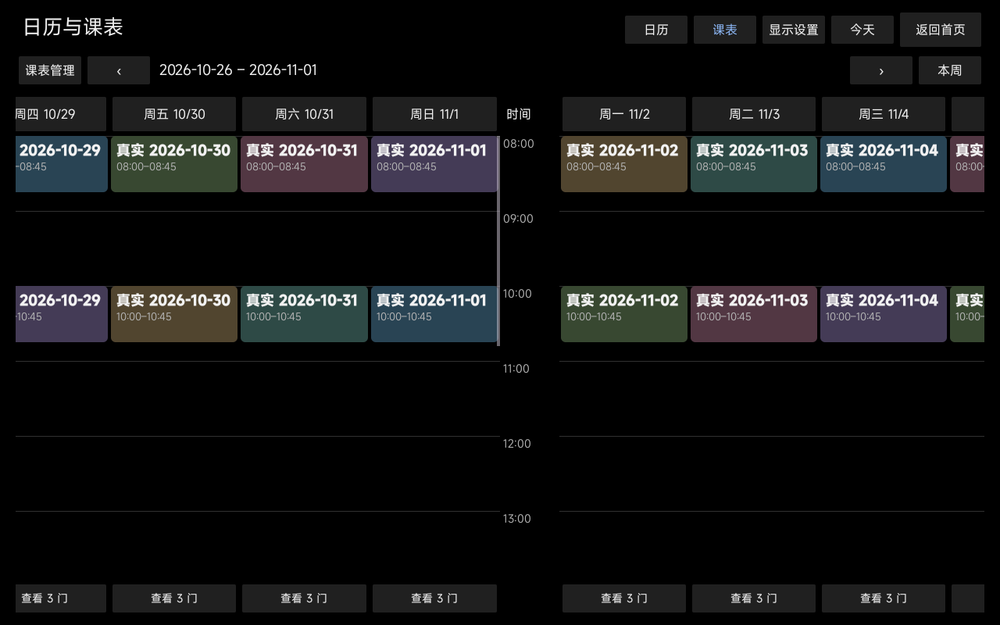
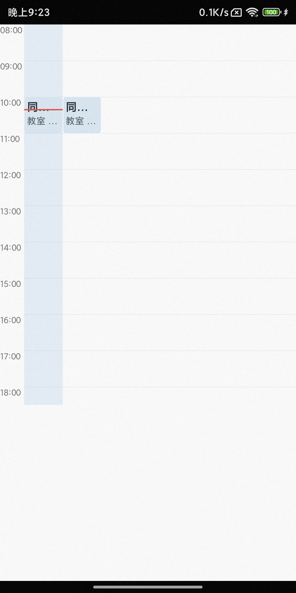
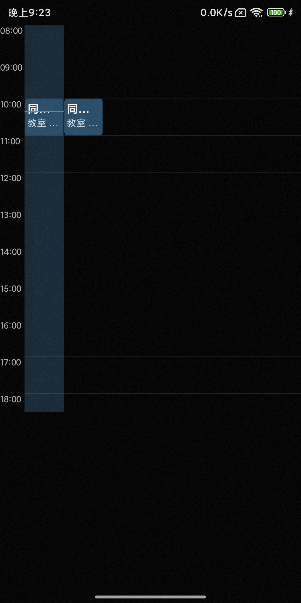

# PR64 收尾验收

> 首次预览性能的最新测量与限制见[后续性能记录](../performance/README.md)。本页 192–276ms 为该轮历史数据；后续虽有改善，仍未完全达到流畅目标。

2026-10-27，继续原 Draft PR64，基于 `3620ba4`。仅调整真实相邻页预览、核查 Phone 今天背景、扩大 X08E Home；不改课程/同步/持久状态结构、配色、节次轴或其他按钮尺寸。仍只安装独立 testbed，不覆盖日用 App。

## 三项结果

1. **真实双页跟手预览**：横向锁定后才按目标日/周构建一个只读页面。当前页位移 `dx`，目标页位移 `±width + dx`，位移上限为完整一屏；半屏拖动能看到半屏目标页。反转越过起点后释放旧预览并构建另一方向。回弹/提交均由一个 200ms ValueAnimator 同步驱动两页，不用 Bitmap、淡出或复制当前课程。提交直接转正同一棵预览视图，保留已测量的坐标与滚动位置；不再导航后重建课程或二次入场。系统关闭动画时同步提交。
2. **Phone 蓝色背景没有覆盖卡片的问题**：`updateNow()` 的列背景在底层；同一 source/series 的卡片背景不透明，卡片 alpha 为 1，今天/非今天卡片背景像素一致。红线作为列最后一个子 View，位于卡片之上且在正确时间位置。深浅色均核查通过，保留原蓝色、卡片颜色、文字及红线，没有修改 `CourseCard` 配色或今天高亮规则。
3. **X08E Home**：仅此按钮设置最小宽度 112dp、布局高度 56dp、水平 padding 16dp。保留右上角与原回调。中文/英文标题栏均无重叠，按钮布局范围与触摸范围一起扩大，未增加隐藏 TouchDelegate。

预览构建接受显式目标日期，不临时改 selected/Session/显示偏好。预览交互门控关闭、阻止后代焦点并从无障碍树隐藏；日期按钮、课程、重叠选择及编辑入口不能执行。Phone 时钟关闭，X08E `clockAllowed=false`；预览不创建 ScheduleDisplay、同步监听或常驻任务。转正才启用交互及该页时钟。刷新、取消、多指、失去焦点、尺寸变化、模式切换、重建及关闭开关均释放预览；动画回调用动作代次防止过期提交。X08E 初建/转正时避免重复主题上色，正常主题切换仍更新整个课表。

## 实际验证

物理 Phone 为 MIX 2S / API 33 / 1080×2160，物理 X08E 为 API 28 / 1280×800。模拟器为 API 28 / 1280×800。使用拒绝写入的 Fake Store、隔离内存数据库及明确标注日期的合成课程；相邻周课程身份和标题不同。未运行无关协议、fnOS 或 soak 测试。

| 验证 | 结果与证据 |
| --- | --- |
| 两端 App 与 AndroidTest 构建 | PASS：[两端构建](build-both.txt)、[X08E 最后构建](build-x08e-final.txt) |
| Phone 实机定向 UI | 6/6 PASS：[日志](phone-physical.txt)。日、周 5/7 天与两种轴；双方向 25%/50%/80% 真实内容和位移；未锁定 DOWN 不创建预览；反转/CANCEL/刷新/重建释放；同一预览转正、偏移不变；转正后详情可点击。并回归跨年/跨月、按钮和开关、竖向滚动、短课/重叠命中、多指、fling、回弹与数据刷新。 |
| X08E 实机定向 UI | 6/6 PASS：[日志](x08e-physical.txt)。经典/时间/节次三种布局的上述位置、真实内容、转正与释放断言；转正后详情；经典七列独立滚动、网格分钟锚点、主题和刷新；原 MainActivity 的 Home 与首页左划往返。 |
| 关闭系统动画 | Phone、X08E 各 1/1 PASS：[Phone](phone-zero.txt)、[X08E](x08e-zero.txt)。复用覆盖所有模式、双方向及 25/50/80% 的预览测试，确认提交不依赖动画完成回调；模拟器设置已恢复。 |
| 今天背景深浅色核查 | 包含在 Phone 6/6 中；真实 Android View 绘制采样检验卡片 alpha/ARGB、今天/非今天同色、底层蓝色和红线位置，并检查实机截图。 |
| Home 中英文 | 包含在 X08E 6/6 中；实机检查尺寸/标题栏无重叠与页面内 MotionEvent 四侧命中；[API 28 模拟器原生四侧点击 1/1 PASS](home-native-api28.txt)。实机直接由 Espresso 点击最右侧时遇到系统窗口注入权限错误，没有把该失败称为通过；实际 Home 中心及首页往返原生注入通过。 |
| 连续原生拖动录像 | [Phone 实机测试](phone-native-recording.txt)、[X08E 模拟器测试](x08e-native-recording.txt)各 1/1 PASS：不同日期夹具，真实系统触摸注入、完整方向切换与短拖回弹。 |

## 截图与录像

下列半屏截图取自 **UP 之前**，工具栏仍显示原周，内容区域同时显示本周后半与真实下周前半；不是成功切换后的入场动画。

| Phone 周视图半屏 | X08E 时间网格半屏 |
| --- | --- |
|  |  |

[Phone 日视图半屏](screenshots/phone-day-half.png)、[Phone 节次半屏](screenshots/phone-periods-half.png)、[X08E 经典半屏](screenshots/x08e-classic-half.png)、[X08E 节次半屏](screenshots/x08e-periods-half.png)。

| 今天列 / 非今天列：浅色 | 今天列 / 非今天列：深色 |
| --- | --- |
|  |  |

上图两张卡片使用同一课程身份；左列为固定核查时钟的今天，右列为非今天。蓝色只在卡片周围可见，红线覆盖左侧卡片。截图使用隔离合成视图，没有修改设备日期。

[Home 中文](screenshots/x08e-home-zh.png)、[Home 英文](screenshots/x08e-home-en.png)。[Phone 实机连续拖动录像](videos/phone-real-preview.mp4)、[X08E API 28 模拟器连续拖动录像](videos/x08e-api28-real-preview.mp4)。视频去掉了测试前后桌面片段；X08E 物理编码器不可用，未把模拟器录像标成实机。

## 性能与剩余边界

- 断言验证最多当前页加一个预览；预览时钟不活跃，结束后只剩一个页面。没有整页 Bitmap、持续离屏渲染或新增后台任务。这里的颜色取样 Bitmap 仅存在于 instrumentation 测试，不进入应用预览实现。
- X08E 的 21 门合成课夹具，最终六次首个 MOVE（含投影、构建、挂载和测量）耗时 **192–276ms**，详见[采样](x08e-first-preview-timing.txt)。已去掉重复主题上色，但没有证明确定性的前后性能收益。首次准备仍可能造成起手顿挫；**不宣称零延迟、稳定 60fps 或通过了完整性能基准**。页面建好后的 MOVE 只更新两页 translation，转正复用该视图。
- 尚未量化长期 CPU、峰值内存或做人工 TalkBack 流程验收。未更动日用客户端、Launcher、原厂服务或同步数据，也未据此声称原厂功能全量通过。

测试入口：`TimetableSwipeTest` 的 `realAdjacentPagesFollowAtQuarterHalfAndEightyAndPromoteWithoutRebuild`、`todayBackgroundIsBelowOpaqueCardsAndRedLineInBothThemes`、`nativeDistinctDatePreviewRecording`；`X08eScheduleDisplayTest` 的 `pr64RealAdjacentPreviewGeometryPromotionAndCleanupAcrossLayouts`、`pr64HomeBoundsChineseEnglishAndEdgeTouches`、`pr64NativeDistinctWeeksPreviewRecording`。其余入口名称在对应日志中。使用 testbed APK；Home 实机页面内分发验证传 `-e homeDirect true`，模拟器原生点击不传此参数。

## 追加：Apps 页返回首页按钮

按用户追加要求，Apps 页按钮文字由 Home 改为「返回首页」，宽度从 144dp 增至 176dp，高度保持 56dp，原 `onReturnHome` 行为不变。只修改 Apps 专用文字资源与此按钮宽度。

[构建通过](apps-home-build.txt)；X08E 实机复用 `AppsAndroidTest.gridOwnsScrollHomeButtonReturnsAndFavoritesSurviveNewViewModel`，[1/1 PASS](apps-home-ui.txt)，覆盖应用列表滚动、深浅色、重建、按钮回首页及收藏保持。使用隔离 testbed 与合成应用列表。[实际截图](screenshots/apps-home.png)。
