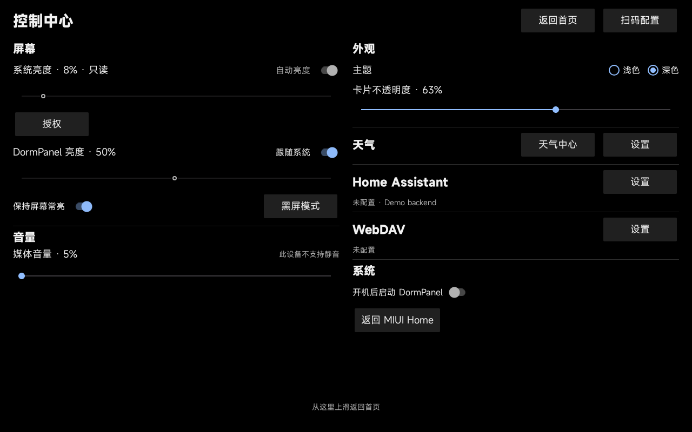

# PR82 · X08E 控制中心布局

- 顶部固定显示控制中心标题、DormPanel 首页按钮和统一扫码配置。底部的「从这里上滑返回首页」是固定上滑区，从该区域起手可返回首页。
- 两列共用一个滚动容器。左列是设备显示和音量，右列是外观、天气、Home Assistant、WebDAV 和系统。内容区起手的竖滑由滚动容器处理，滑块继续认领自己的触摸流。
- 标题、开关和操作使用 dp/sp 排版。按钮使用 18sp 文本及至少 144×56dp 的触控区。开关、主题选项和滑块保留约 48dp 高的触控区。长服务状态在独立行完整换行，并随内容一起滚动。
- 系统亮度只读时保留授权按钮。黑屏按钮位于常亮开关行的最右侧。本机不支持静音时在音量旁显示提示。支持静音时，同一位置切换「静音」和「取消静音」。
- HA 和 WebDAV 的设置位于各自标题右端。天气设置和天气中心共享天气标题行。WebDAV 已配置时显示服务主机名。

## 验证范围

在 X08E（Android 9、1280×800、160 dpi）使用隔离测试包 `com.dormpanel.app.testbed`。默认字体下检查首屏，在控制中心的测试视图中单独应用 150% 字体，在较矮的测试视口中用触摸滚动至末项。HA 鉴权错误来自本地 WebSocket 测试服务，另外用加长文本检查完整换行。支持静音的设备分支使用测试音量端口，X08E 的无静音分支和实际媒体音量由实机覆盖。

Android Debug 和隔离测试 APK 构建成功。19 项相关仪器用例通过，包含实际设备滑块拖动、外部音量观察、系统亮度有权和无权、主题切换及页面重建、扫码、HA、WebDAV、天气、黑屏、开机自启和返回手势。授权亮度用例完成后恢复系统亮度原值及自动模式。另在实机点击「返回 MIUI Home」，确认前台切换到 `com.xiaomi.micolauncher/.Launcher`。

系统级字体修改触发了设备 ROM 的 SystemUI 崩溃提示，已恢复原字号并关闭提示。150% 字体结果来自实机上的视图级配置。静音切换使用替代音量端口验证，未另接支持静音的物理设备。

下图为默认字体、深色、无系统亮度写权限、HA 和 WebDAV 未配置时的实机首屏。

