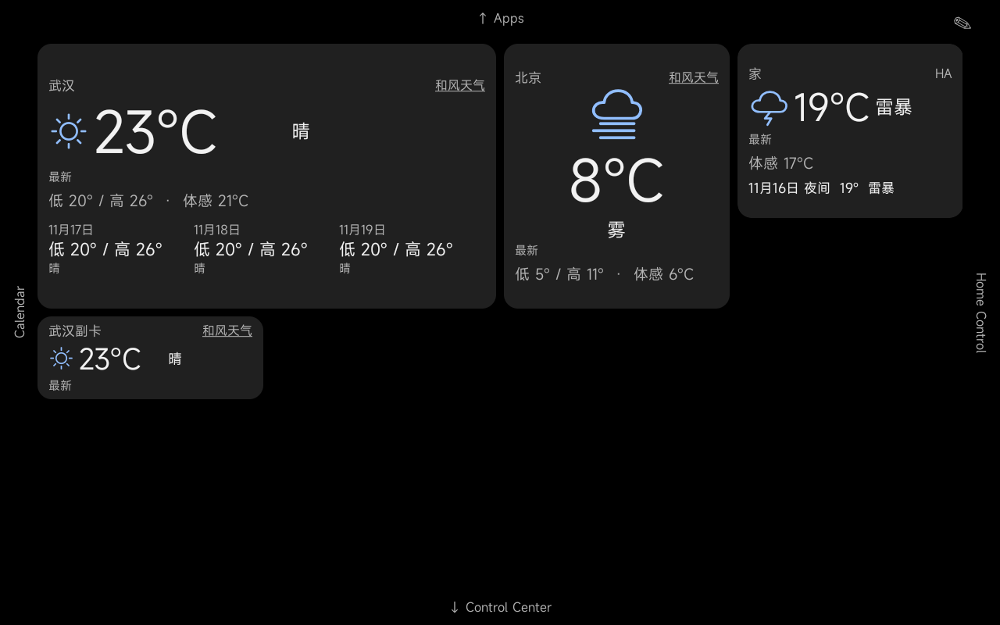

# PR83 · X08E 天气卡片验收

卡片的当日温度和每日预报使用紧凑区间，例如 `18–27°C`；只有一端时显示「最高」或「最低」。HA 卡片按来源温标显示，详情和完整天气中心沿用原来的格式。已绑定地点按该地点的时区计算日期；未绑定地点的旧版 HA 和 Demo 数据使用设备时区。卡片在地点午夜重新排版日期，无需重新请求天气。

一行高的卡片优先显示当前读数；两行高的卡片以一行显示最近的预报；三行高的卡片纵向显示预报日期、天气图标、温度和描述。较窄的 2×3 将当前温度和天气描述叠放。高度足够时，「明天」或星期下方显示较小的具体日期。

Android Debug、X08E testbed 及其仪器测试 APK 构建成功。25 项相关 JVM 测试通过。X08E 实机（Android 9、1280×800、160 dpi）上的 5 项天气卡片相关 UI 测试通过，覆盖：

- 九种合法尺寸的文字与图标边界，以及大 → 小 → 大的字号恢复。
- 默认深色和测试视图中应用的浅色与 130% 字体，包含长地点名、长天气描述、三位数负温、小数和单个预报。
- 使用受控时钟跨越午夜，天气源不变时「明天」更新为「今天」。
- 多天气卡片独立取数、和风归因链接、点击、长按、切换来源、失效来源和旧卡片。

实机用隔离 testbed 与固定天气数据完成布局与交互验证，未使用生产 HA 或和风凭据。

额外运行的完整天气中心用例 `fakeWeatherRendersForecastAndOnlyOpensSpecialtyDemandOnSelection` 在「上弦月」不在可见区域的断言处失败。用最新 `main`（`267646a`）构建隔离 APK 后在同一台设备复现了相同失败。

下图为同一组测试数据在旧版和新版的对照：4×3、2×3、2×2 和 2×1。

另见 [3×3 Demo 卡片](pr83-x08e-weather-3x3.png)和 [3×2 Demo 卡片](pr83-x08e-weather-3x2.png)。
