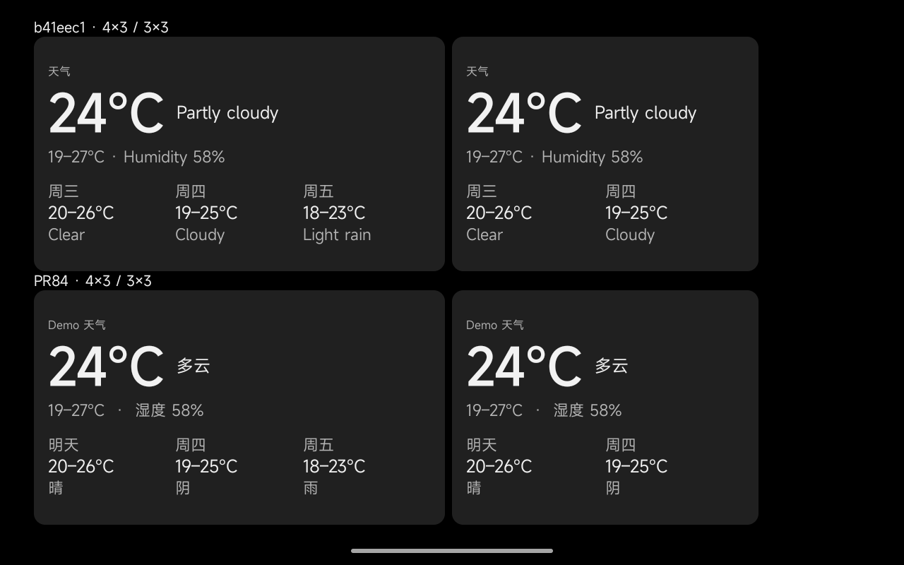

# PR84 · X08E 经典天气验收

Debug、X08E testbed 和仪器测试 APK 构建成功。桌面模块 61 项 JVM 测试通过。

在 Android 9、1280×800、160 dpi 的 X08E 上，8 项保留的仪器测试通过。

- 添加界面显示两种天气卡片。实机触控覆盖点击、长按、拖动、归因链接、独立换绑、显示设置、保存失败和重试。重新打开 Activity 后恢复卡片，另用隔离磁盘 Room 数据库验证两种卡片的类型、配置、位置和尺寸。
- 覆盖经典版九种尺寸、深色与浅色、100% 与 130% 字号，以及缩小后放大。检查长描述、温度区间、湿度、只有最高温、缺失当前温度、离线过期和地点或来源失效。
- 使用 Demo 和固定的和风及 HA 快照。记录底层供给的启动与停止，验证同源的两种样式共享请求，换绑、移除和 detach 后释放各自的需求。HA 昼夜预报可在经典卡片中显示。
- 新版保留原有图标和布局，相关实机测试覆盖字号适配、单行读数和午夜更新。默认字号单行截图的卡片区域与 PR83 对应截图逐像素一致。

实机对照图使用相同的 Demo 数据。上排在隔离 testbed 内渲染 `b41eec1` 的历史卡片源码，下排为经典天气。左右分别为 4×3 和 3×3。经典版使用现有地点名称、中文天气描述和相对日期。

[查看两种样式在同一桌面的实机截图](pr84-mixed-weather-cards.png)

验证使用隔离测试数据和模拟天气服务，生产 HA、和风凭据和整机重启未纳入此次实测。
